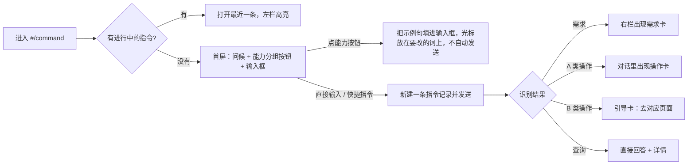

# 「需求对话」改名与入口体验重做（只出设计，不改代码）

基线：main `3b80e38`（PR #3 合入后）。
文案规则：说人话、用简体中文；id、模型名、费用、版本号这类原始数据收进「详情」折叠区；组件用 shadcn，视觉用赛博朋克风格（等宽小标签 `XXX //`、切角、霓虹描边），这些都沿用现有样式，不新增设计体系。

## 1. 为什么要改

这个页面现在能做五类事：提需求、新建产品线、新建项目、邀请成员、查状态。继续叫「需求对话」，用户会以为只能提需求，其它四件事就没人发现了。助手的人设现在叫「需求录入与工作流编排助手」，也只讲了需求这一件事。

## 2. 名字候选

| 候选 | 好处 | 问题 |
|---|---|---|
| **指挥台**（英文标签 `COMMAND DECK`） | 有赛博朋克的感觉，一听就是「在这里下指令、发起操作」；和 7x24 全天候自治的定位对得上 | 有点抽象，第一次来的人需要一句副标题说明 |
| 7x24 助手（`ASSISTANT`） | 最直白，谁都看得懂 | 太普通，和其它产品没区别；「助手」听起来像只会答问题、不能执行操作 |
| 工作台对话（`OPS CHAT`） | 说清了「工作台 + 对话」 | 四个字比较啰嗦，导航栏放不下也不好记 |

**推荐「指挥台」**。副标题写「用一句话提需求、建产品线和项目、邀请成员、查进度」；助手在页面里自称「7x24 助手」（名字取自候选 2）。页面名和助手名分开，既有品牌感，大家也知道在跟谁说话。

## 3. 现在哪些地方用了这个名字（基于 3b80e38）

| # | 位置 | 现在的文案 / 标识 |
|---|---|---|
| 1 | 导航 `App.tsx:32` | `{ id: 'chat', label: '需求对话', code: '01' }` |
| 2 | 页头 `Chat.tsx:42` | 标题「需求对话」；说明「和录入助手聊几句：它会探测仓库结构、追问目标与可量化的验收标准…」 |
| 3 | 页头按钮 | 「新对话」 |
| 4 | 左栏 | 「会话轨道」`SESSIONS // n`；空状态「还没有对话，点击右上方「新对话」或右侧蓝图卡开始」 |
| 5 | 首屏 | 「需求蓝图启动台」`SELECT SCENARIO OR INITIALIZE DIALOGUE`、「SYS.READY // 对话式需求与工作流合成器」、「新建需求对话」，4 张蓝图卡，每张有「以此模式启动」 |
| 6 | 右栏 | 「动态工作流遥测面板」，3 段说明 |
| 7 | 空对话提示 | 「说说你想要什么。比如：「订单列表接口加个分页」…也可以直接说「新增产品线 教育」…」 |
| 8 | 输入框 | 「描述需求，或回答助手的问题…（Enter 发送，Shift+Enter 换行）」 |
| 9 | 输入框关闭时 | 「已创建任务，会话已关闭。」「只读成员不能发消息。」「会话已关闭。」 |
| 10 | 会话状态 | 进行中 / 已创建任务 / 已放弃 / 待审批；没有标题时显示「未命名需求」「新需求」 |
| 11 | 删除 | 「删除「…」？」「对话记录和需求草稿会一起删除…」；提示「已删除需求对话，任务已保留」 |
| 12 | 需求卡 | 「需求草稿」「确认创建任务」「提交审批」「批准并创建任务」「保存草稿」「预检通过，可以确认」 |
| 13 | 操作卡 `Chat.tsx` 中的 `ActionCard`、`lib/chat.ts` | 待确认 / 已执行 / 已取消 / 失败；「你的角色不能执行，需要工作区…来确认」；提示「已执行」「这个操作之前已经执行过」「邀请链接已复制」 |
| 14 | 事件文案 `lib/eventText.ts:120-122` | 「由需求对话确认创建」「在需求对话里补充后重新确认」「来源需求对话已删除，任务保留」「需求信息不足，已退回需求对话」 |
| 15 | 任务详情 `TaskDetail.tsx:108` | 「需求待澄清（已退回需求对话）」 |
| 16 | 术语表 `copy/terms.ts:50` | `'chat.intake': '需求对话'` |
| 17 | 系统提示词 `IntakePrompt.SYSTEM` | 「你是 7x24 持续交付平台的「需求录入与工作流编排助手」」；规则 4「请检查右侧需求卡…」 |
| 18 | 后端写进对话的消息 | `ChatService` 的「我已更新草稿，请查看右侧需求卡。」、澄清提示「PRD 评审没有通过…」；`ChatActions.summary`；规则回复「我准备好了下面这个操作…」 |
| 19 | 写进 PRD 的来源标记 | `Draft.java:45` 写入 `_来源：需求对话_`，`LlmAgents.java:80` 靠这段文字判断任务是不是来自对话 |
| 20 | 路由 / 接口 | 前端 `#/chat`、`#/chat/{id}`；接口 `/api/chats/*`；模型角色 `intake.chat` |
| 21 | 文档 | `docs/design/chat-intake-and-adaptive-pipeline.md`、`agent-chat-actions.md`，以及代码注释 |

## 4. 第一次进来看到什么

### 4.1 首屏线框

```
┌ 导航 ─────────┐┌──────────────────────────────────────────────────────────────────────┐
│ 01 指挥台  ◀  ││ 指挥台                                        [+ 新指令]              │
│ 02 任务       ││ 用一句话提需求、建产品线和项目、邀请成员、查进度                       │
│ …             │├──────────────┬───────────────────────────────────────┬──────────────┤
└───────────────┘│ 指令记录     │ CMD.READY // 7x24 助手                 │ 当前上下文    │
                 │ LOG // 12    │ 你好 @alice，你在「教育」工作区是管理员。│ 工作区 教育   │
                 │ ▸ 成绩导出   │ 今天想做什么？                         │ 产品线 [全部▾]│
                 │   已建任务   │                                        │ 项目   [全部▾]│
                 │ ▸ 新建官网项目│ ── 需求 ──────────────────────────────│ ──────────── │
                 │   已执行     │ [提一个需求] [后端接口] [前端页面]       │ 你的角色：管理员│
                 │ ▸ …          │ [数据迁移] [小改动·极速]                │ 可以：建产品线 │
                 │              │ ── 产品线与项目 ──────────────────────│  建项目、邀请  │
                 │              │ [新建产品线] [新建项目]                 │  成员/只读     │
                 │              │ ── 成员 ──────────────────────────────│ 不可以：邀请   │
                 │              │ [邀请成员] [邀请管理员 🔒仅所有者]       │  管理员        │
                 │              │ ── 查询 ──────────────────────────────│ （原因 ⓘ）    │
                 │              │ [我的任务进度] [哪些任务卡住了] [项目列表]│ ▸ 详情        │
                 │              │                                        │  工作区 id…   │
                 │              │ ┌────────────────────────────────────┐ │              │
                 │              │ │ 试试：「新建项目 官网 到产品线 教育」 │ │              │
                 │              │ │ 输入 / 查看快捷指令                  │ │              │
                 │              │ └────────────────────────────────────┘ │              │
                 └──────────────┴───────────────────────────────────────┴──────────────┘
```



### 4.2 问候语

- 管理员或所有者：「你好 @{login}，你在「{工作区}」是{角色}。今天想做什么？可以提需求，也可以直接让我建产品线、建项目、邀请成员。」
- 成员：「你好 @{login}。你可以提需求、查进度；建产品线、建项目、邀请成员需要管理员确认，我可以先帮你把操作卡准备好。」
- 只读成员：「你好 @{login}。你是只读成员，可以看进度和历史记录，不能发起操作。需要权限请找工作区管理员。」不显示输入框，只显示查询按钮（只读成员只能用查询按钮，不能自由发问，见待定 D5）。

### 4.3 能力按钮（按角色显示）

| 分组 | 按钮 | 点击后填进输入框的句子 | 谁能用 |
|---|---|---|---|
| 需求 | 提一个需求 | 「我想要……」 | 成员及以上 |
| | 后端接口 / 前端页面 / 数据迁移 / 小改动·极速 | 沿用原来 4 张蓝图卡的场景，不再单独占一块面板 | 成员及以上 |
| 产品线与项目 | 新建产品线 | 「新建产品线 {名称}」 | 管理员及以上可以确认；成员能看到，但按钮带锁 |
| | 新建项目 | 「新建项目 {名称} 到产品线 {当前产品线} 仓库 {owner/name}」 | 同上 |
| 成员 | 邀请成员 | 「邀请 @{账号} 为成员」 | 管理员及以上 |
| | 邀请管理员 | 「邀请 @{账号} 为管理员」 | 只有所有者 |
| 查询 | 我的任务进度 / 哪些任务卡住了 / 项目列表 | 直接发送 | 所有人 |

没权限的按钮：灰色加 🔒，悬停提示「需要工作区管理员确认。你可以先发起，卡片会留给管理员处理」（邀请管理员提示「只有所有者可以邀请管理员」）。成员点了照样能生成卡片，这和后端「卡片留给有权限的人确认」的规则一致；只读成员的按钮直接隐藏。

### 4.4 输入框示例轮换

每 4 秒换一句，输入框获得焦点后停止轮换。只轮换当前角色能用的句子：
1. 「成绩页想加个导出 CSV」
2. 「新建产品线 教育」
3. 「新建项目 官网 到产品线 教育 仓库 acme/site」
4. 「邀请 @octocat 为成员」
5. 「这周有哪些任务卡住了？」

每句末尾都带「· 输入 / 查看快捷指令」。

### 4.5 快捷指令（输入 `/` 弹出，用 shadcn Command 组件）

| 指令 | 作用 | 实现方式 |
|---|---|---|
| `/需求` `/req` | 进入需求整理流程，可以选场景 | 用原有的 presetId |
| `/产品线` `/line` | 新建产品线 | 直接走规则解析，不调用模型 |
| `/项目` `/project` | 新建项目，会提示填名称、产品线、仓库 | 同上 |
| `/邀请` `/invite` | 邀请成员 | 同上 |
| `/查` `/status` | 查询 | 只读工具 |
| `/帮助` | 列出能做什么、不能做什么 | 本地显示，不请求接口 |

快捷指令只是把句子写好填进输入框，**不会因此跳过确认卡**。

### 4.6 当前上下文

右栏顶部显示「工作区 / 产品线 / 项目」。产品线和项目可以下拉切换，切换后作为新建项目、需求草稿的默认值，不再需要用户在句子里写清楚。新建会话时把上下文一起带上（现在 `projectId` 已经有了，需要再加 `productLineId`，见待定 D3）。原始 id 收进「详情」。

## 5. 操作卡各状态的文案

| 状态 | 标签（Badge 颜色） | 卡片正文 | 按钮 |
|---|---|---|---|
| 待确认 | 待确认（primary） | 「请检查下面的内容，确认后我会用你的身份执行。」 | 取消 / 确认 |
| 执行中（新增，前端点击后显示） | 执行中…（accent，带动效） | 「正在执行，请稍等。」 | 两个按钮都不能点 |
| 成功 | 已完成（success） | 新建产品线：「已新建产品线「教育」。」；新建项目：「已新建项目「官网」，[去配置项目 →]」；邀请：「邀请链接已复制，只显示这一次，7 天内有效。」 | 去看看 → |
| 无权限 | 等待有权限的人（warn） | 「你是{角色}，不能执行这个操作。可以把这个对话发给工作区管理员 / 所有者来确认。」 | 复制对话链接 |
| 已取消 | 已取消（neutral） | 「已取消，没有做任何改动。」 | 没有按钮 |
| 失败 | 没有完成（danger） | 「没有完成：{原因}。没有做任何改动。」原始报错收进「详情」 | 重新发起 |
| 重复确认 | 沿用「已完成」 | 提示「这个操作之前已经完成了」 | — |

「无权限」现在只是 403 弹提示，需要把它做成卡片上的一个持续状态（待定 D4）。

## 6. B 类操作的引导卡

用户说「删掉项目 X」「把 bob 改成管理员」时，不生成操作卡，改为显示引导卡：
- 正文：「这个操作需要你在页面上亲自完成，我不能代你执行。」写明原因：不可逆 / 涉及权限 / 涉及费用或密钥。
- 按钮：直接链接到对应页面。

| 用户说的 | 链接到 |
|---|---|
| 删除或归档项目 | `#/project/{id}` 的设置区 |
| 删除或归档产品线 | `#/catalog/{id}` |
| 改角色、移出成员、转让所有者 | `#/workspace` 成员页 |
| 改预算 | `#/budget` |
| 合并、发布审批 | `#/task/{id}` |
| 模型、密钥、集成配置 | `#/models`、`#/integrations` |
| 治理配置 | `#/governance` |

后端做法：模型输出里加 `guide: {topic, targetId?}`，服务端把它映射成固定链接（链接不信任模型给的值），通过新的 SSE 事件 `guide` 推给前端（待定 D6）。

## 7. 出错和离线时的文案

| 情况 | 文案 |
|---|---|
| 模型不可用 / 离线模式 | 顶部提示条：「AI 暂时不可用。明确的指令还能用，比如「新建产品线 教育」「邀请 @账号 为成员」；提需求要等 AI 恢复。」 |
| 只记录模式（ADAPTER_DRY_RUN） | 「当前是只记录模式：需求确认后会生成任务，但不会改仓库。」 |
| 会话费用或轮数到上限 | 「这条指令记录已经聊到上限了，新开一条继续吧。」，附「新指令」按钮；具体金额收进「详情」 |
| 工作区预算触顶 | 「工作区预算用完了，AI 暂停。管理员可以到预算页调整。」[去预算页] |
| 网络中断 | 「连接断了，消息可能没发出去。」[重试] |
| 模型输出不合格 | 「AI 回复的格式不对，已跳过这一轮，请换个说法再试。」原因收进「详情」 |

## 8. 历史列表的叫法

- 左栏标题「会话轨道」改为「**指令记录**」，英文标签 `LOG // n`。
- 列表项标题按会话内容来起：建了任务就用需求标题；只做了操作，就用第一张卡的摘要，比如「新建项目 官网」；什么都没有就叫「新指令」。
- 状态标签：进行中 / 已建任务 / 已完成操作 / 已关闭 / 待审批。
- 筛选：全部 / 需求 / 操作。

## 9. 路由和接口

| 现在 | 改成 | 说明 |
|---|---|---|
| `#/chat`、`#/chat/{id}` | `#/command`、`#/command/{id}` | 旧地址在 `router.ts` 里做 hash 重定向，保留至少 2 个版本；导航 id 改成 `command` |
| `/api/chats/*` | **不改** | 接口不对外暴露名字，改名只会破坏兼容 |
| 模型角色 `intake.chat` | **不改** id | 模型配置里存着这个 id；只把显示名 `terms.ts` 改成「指挥台助手」 |
| 表 `chat_*` | 不改 | — |
| PRD 来源标记 `_来源：需求对话_` | **先不改** | `LlmAgents` 靠这段文字判断来源。如果要改，新旧标记都要认（待定 D2） |
| 通知 / 邮件里的链接 | 指向新路由 | 旧链接靠重定向继续能用 |

## 10. 系统提示词（人设）改成什么

- 现在：「你是 7x24 持续交付平台的「需求录入与工作流编排助手」…」
- 改成：「你是 7x24 指挥台里的「7x24 助手」。用户在这里用对话完成四类事：① 提需求：把想法整理成可以直接进入流水线的需求草稿，并定制工作流；② 管产品线和项目：提议新建，等用户确认；③ 管成员：提议邀请，等用户确认；④ 查询：查进度、项目、风险。不能做的事（删除、改权限、改预算、改密钥和配置、审批）要告诉用户去哪个页面。」
- 需求相关的规则全部保留。规则 4 的「右侧需求卡」保持不变；问候语和能力介绍由前端显示，模型不用重复说。
- `PROMPT_VERSION` 从 `intake-v1` 升到 `command-v1`，方便在审计里区分新旧人设。

## 11. 新旧文案对照表

| 位置 | 旧 | 新 |
|---|---|---|
| 导航 | 需求对话 | 指挥台 |
| 页头标题 | 需求对话 | 指挥台 |
| 页头说明 | 和录入助手聊几句：它会探测仓库结构… | 用一句话提需求、建产品线和项目、邀请成员、查进度。会改动数据的操作，都要你确认后才执行。 |
| 新建按钮 | 新对话 / 新建需求对话 | 新指令 |
| 左栏标题 | 会话轨道 `SESSIONS` | 指令记录 `LOG` |
| 左栏空状态 | 还没有对话，点击右上方「新对话」或右侧蓝图卡开始 | 还没有记录。在中间输入框说一句话就能开始。 |
| 首屏标题 | 需求蓝图启动台 `SELECT SCENARIO…` | `CMD.READY // 7x24 助手` + 问候语 |
| 首屏副标题 | SYS.READY // 对话式需求与工作流合成器 | （删掉，由问候语代替） |
| 蓝图卡按钮 | 以此模式启动 | 改成「需求」分组里的按钮 |
| 右栏 | 动态工作流遥测面板（3 段） | 当前上下文 + 你的权限；原来 3 段说明收进「详情 · 工作流怎么定」 |
| 空对话提示 | 说说你想要什么。比如… | （改为首屏按钮 + 输入框轮换示例） |
| 输入框 | 描述需求，或回答助手的问题…（Enter 发送，Shift+Enter 换行） | 轮换示例 + 「· 输入 / 查看快捷指令」；Enter 发送和 Shift+Enter 换行的提示移到输入框下方的小字 |
| 会话已关闭 | 已创建任务，会话已关闭。 | 这条记录已建任务并关闭。有新想法请新开一条指令。 |
| 只读 | 只读成员不能发消息。 | 你是只读成员，只能查看。需要权限请找工作区管理员。 |
| 未命名 | 未命名需求 / 新需求 | 新指令 |
| 状态 | 已创建任务 / 已放弃 | 已建任务 / 已关闭；新增「已完成操作」 |
| 删除提示 | 已删除需求对话，任务已保留 | 已删除这条记录，由它创建的任务不受影响 |
| 删除确认 | 对话记录和需求草稿会一起删除… | 这条记录里的对话、需求草稿、操作卡会一起删除，删了不能恢复。已经执行的操作和创建的任务不受影响。 |
| 操作卡 | 待确认 / 已执行 / 已取消 / 失败 | 待确认 / 执行中… / 已完成 / 等待有权限的人 / 已取消 / 没有完成 |
| 操作卡没权限 | 你的角色不能执行，需要工作区…来确认 | 你是{角色}，不能执行这个操作。可以把这个对话发给管理员来确认。 |
| 操作卡提示 | 已执行 / 这个操作之前已经执行过 | 已完成 / 这个操作之前已经完成了 |
| 规则回复 | 我准备好了下面这个操作，请检查参数后点「确认」执行… | 我把操作卡准备好了，检查没问题就点「确认」。 |
| 模型回复兜底 | 我已更新草稿，请查看右侧需求卡。 | 我更新了右侧的需求卡，你看看。 |
| 事件 | 由需求对话确认创建 | 由指挥台确认创建 |
| 事件 | 在需求对话里补充后重新确认 | 在指挥台补充后重新确认 |
| 事件 | 来源需求对话已删除，任务保留 | 来源的指令记录已删除，任务保留 |
| 事件 | 需求信息不足，已退回需求对话 | 需求信息不够，已退回指挥台补充 |
| 任务详情 | 需求待澄清（已退回需求对话） | 需求待澄清（已退回指挥台） |
| 术语表 | chat.intake → 需求对话 | chat.intake → 指挥台助手 |
| 人设 | 需求录入与工作流编排助手 | 7x24 助手（指挥台） |
| 需求卡 | 需求草稿 / 确认创建任务 | 保持不变（这张卡本来就只管需求） |

## 12. 已定事项（2026-10-23 拍板）

- **D1 名字：** 定为「指挥台」，助手自称「7x24 助手」。
- **D2 PRD 来源标记：** `_来源：需求对话_` 不改。
- **D3 产品线上下文：** 要做。会话新增 `product_line_id` 字段（新迁移，H2 和 PostgreSQL 都加；表本身已经有行级安全，不用再加策略）。新建会话、切换上下文时保存；新建项目卡默认用它。
- **D4 无权限状态：** 持久化。成员确认被拒时，卡片标记为「等待有权限的人」（`blocked_role` 字段记录需要什么角色）；卡片上有「复制对话链接」，有权限的人打开后可以继续确认。
- **D5 只读成员：** 可以自由提问、查询，拿到回答；**不能**创建或确认任何操作卡、不能修改需求草稿、不能确认任务。服务端强制：工作区过滤器只放行只读成员调用 `POST /api/chats`、`/api/chats/{id}/messages`、`/api/chats/{id}/stop`；这一轮里模型输出的草稿补丁、操作提议、规则指令一律忽略，并在回复里说明「只读成员不能发起操作」。前端隐藏操作按钮。
- **D6 引导卡：** 做成新的 SSE 事件 `guide` 加服务端固定链接表，模型只能给出主题（topic），不能给链接。
- **D7 历史筛选：** 做。会话列表返回操作卡数量 `actions`，前端按 全部 / 需求 / 操作 筛选。
- **D8 旧路由：** `#/chat` 重定向到 `#/command`，至少保留 2 个版本。

## 13. 实施（三个 PR，依次叠加）

1. PR-A：改名、文案和路由（第 11 节对照表、第 9 节路由，含后端写进对话的文案）。
2. PR-B：首屏（问候语、按角色显示的能力按钮、输入框轮换示例、快捷指令）、右栏上下文和 D3 产品线字段、D7 历史筛选。
3. PR-C：操作卡「执行中」和持久化的「无权限」状态（D4）、B 类引导卡（D6）、只读成员可提问（D5）、人设提示词升级到 `command-v1`。
