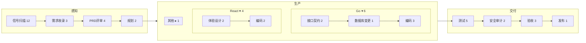

# 可组合流程：节点目录 + 按需求组装的任务级 DAG（设计）

> 状态：**已确认（2026-10-17，D1–D10 全部采用推荐项，看板采用方案 A）**，按 P0 → P5 顺序实施（见 §15、§16）。
> 基线：`codex/product-line-project-architecture` @ 300cc7a。
> 关联：`chat-intake-and-adaptive-pipeline.md`（C1/C2：任务级流程计划、规则分类、放松审批）、`model-config.md`（模板四层合并、技能、角色）、`workspaces.md`（工作区隔离、RLS、配额）。

## 0. 结论

1. **不再以「流程模板」为中心，改为「节点目录 + 组装」**。平台维护一份覆盖全部可能节点的 **节点目录**。每个需求在对话录入或建任务时，由「规则基线 + AI 增删」组装出它自己的流程，校验后钉成不可变的 **任务流程图快照（DAG）**。
2. **三个模块**：
   - **感知**：信号扫描、需求收录、PRD 评审、规划。各项目通用，固定节点。
   - **生产**：设计、编码、专项检查。**按技术栈不同**，例如 Go 服务用接口契约设计、Go 规范、SQL 安全检查，React 前端用体验设计、React 规范、多语言检查。
   - **交付**：测试 / CI、安全审计、验收、发布。各项目通用，固定节点。
3. **项目级技术栈画像**决定生产模块可用哪些节点，也决定规则基线。治理规则决定哪些节点必须有（例如风险 ≥ 中时必须做安全审计）。
4. **引擎改为通用执行**：按 DAG 拓扑序调度节点，每类执行方式（agent / review / check / system）一个执行器。挂在测试之后的节点（安全审计）也能真正执行，修掉现在挂在验收阶段的自定义节点不会执行的问题。
5. **模板降级为「预设」**：预设只是组装时的起点，或手动建任务时的快捷选择，不再绑定到业务线。现有 `default@1`、`web-fullstack@1`、`docs-only@1` 平滑迁移成预设。
6. **总览看板保持工作区汇总**（业务线 / 项目筛选缩小范围）：感知、交付两段固定；生产段按节点族列出筛选范围内实际用到的节点并集，按栈分段着色，低频节点收进「+N 更多」，点节点列出任务（§10，推荐方案 A）。
7. 先做 4 个前置修复（P0，约 2 天），立即改善现状。完整方案 P0–P5 约 17 人天，分 6 期（§12）。

```mermaid
flowchart LR
  subgraph 目录层
    NC[节点目录<br/>内置 + 工作区派生] --- SK[技能目录]
    GOV[治理规则<br/>必选节点 / 自治等级 / 预算 / 变更上限]
  end
  subgraph 项目层
    SP[技术栈画像<br/>modules→stack] --> AL[项目允许节点]
  end
  subgraph 组装
    D[需求草稿<br/>路径 / 分类多标签 / 风险 / 规模] --> RB[规则基线]
    AL --> RB
    RB --> AI[AI 增删提议<br/>propose_pipeline]
    AI --> V[校验器<br/>DAG / 依赖闭包 / 必选 / 收紧放松 / 技能]
    GOV --> V
    V --> SNAP[(任务流程图快照<br/>不可变, 内容寻址)]
  end
  SNAP --> ENG[通用引擎<br/>拓扑调度 + 执行器注册表]
  ENG --> EX[stage_execution / 证据 / 评审]
  EX --> BOARD[工作区汇总看板<br/>感知 · 生产(节点族×栈) · 交付]
```

## 1. 现状与问题（对照代码）

| 位置 | 现状 | 问题 |
|---|---|---|
| `Catalog.STAGE_TYPES` | 9 个固定节点 INTAKE…RELEASE，只有 SPEC / DESIGN 可选 | 节点集合封闭，生产模块不能按技术栈区分 |
| `Catalog.TEMPLATES` | `default@1` / `web-fullstack@1` / `docs-only@1`，绑定到业务线 | 一条业务线一个模板，同一项目里前端、后端、文档类需求只能共用一套 |
| `Catalog.STAGE_PRESETS` | API_DESIGN / DB_SCHEMA / SEC_AUDIT 原型（bd87ec0） | 只能经过对话里的 `insertStage` / `replaceStage` 用上；SEC_AUDIT 没有技能 |
| `PlanService.classify` | 单标签，迁移优先 | 前后端加迁移的需求会被判成 migration，后端和全栈规则全丢 |
| `PlanService.ruleAdjustments` | backend / fullstack 有部分规则（ece5129） | 全栈不加数据库变更设计，开发不按技术栈挂技能 |
| `Plans.apply` | 校验锁定、上限、收紧 / 放松；未知技能直接拒绝整个节点 | 太硬：技能名写错一个，整个节点就丢 |
| `Engine` 规划后补路径（约 567 行） | 只把 `anchorPhase=DESIGN` 的强制节点补进路径 | 挂在测试 / 验收之后的自定义节点（安全审计）**不执行**；`onAcceptance` 是固定评审组 |
| `Status` 枚举 + `onDesign` / `onQa` / `onAcceptance` | 按阶段写死的处理函数 | 新节点只能借用某个阶段的处理函数 |
| `Board.java` | `pipes.resolve(line)` 按业务线取模板 | 看板显示的是业务线模板，不是各任务实际组装出的流程 |
| `stage_execution.stage` | VARCHAR(20) | 自定义节点 id 长度不够 |

## 2. 节点目录模型

节点定义（`NodeDef`，内置在 `Catalog.NODES`，工作区派生节点存表，§9）：

```jsonc
{
  "id": "API_DESIGN", "version": 1, "label": "接口契约设计",
  "module": "production",            // sensing | production | delivery
  "kind": "design",                  // signal | intake | prd | plan | spec | design | dev | check | review | release
  "executor": "agent",               // agent（产出物：maker[+checker]）| review（评审组打分）| check（规则 / CI 检查）| system（扫描 / 发布等无 LLM）
  "slots": { "maker": "design.make", "checker": "review.design" },
  "inputs":  ["prd", "plan"],        // 需要的产出物键
  "outputs": ["apiContract"],        // 产出物键（写入证据与 context.artifacts）
  "requires": ["PRD_REVIEW"],        // 依赖：必须在这些节点之后
  "before":   ["DEV"],               // 顺序约束：必须在这些节点之前
  "stacks":  ["go", "java", "python", "node", "*backend"],   // 适用技术栈；"*" = 通用
  "triggers": { "labels": ["backend", "fullstack"] },         // 规则基线何时自动加入
  "skills":  ["api-contract@1"],     // 默认技能（可被组装补充）
  "risk": "none",                    // 去掉这个节点的风险：none | low | mid | high（决定放松审批）
  "cost": { "llmCalls": 2, "usd": 0.02, "minutes": 2 },     // 预估，供预算预检
  "gate": { "pass": 0.7, "maxLoops": 2 },
  "onFail": "self",                  // 打回到：self（maker 重做）| DEV | PLANNING | degrade
  "mandatory": null,                 // 治理必选条件（见 §5），null = 不强制
  "promptTemplate": "...", "requiredFields": ["endpoints"]
}
```

**初版目录**（初版不并行，都按顺序执行）：

| 模块 | 节点 | executor | 适用栈 | 说明 |
|---|---|---|---|---|
| 感知 | SIGNAL_SCAN | system | * | 仓库扫描 / 候选需求（现有 discovery） |
| 感知 | INTAKE | system | * | 需求收录（对话或手动） |
| 感知 | PRD_REVIEW | agent+review | * | 可走极速通道（S/XS 且低风险） |
| 感知 | PLANNING | agent | * | 拆子任务；**不再决定节点集合**，只在已组装的 DAG 内排子任务 |
| 生产 | SPEC | agent | * | 验收用例 |
| 生产 | UX_DESIGN | agent+review | react / vue / web | 原 DESIGN |
| 生产 | API_DESIGN | agent+review | 后端栈 | 接口契约 |
| 生产 | DB_SCHEMA | agent+review | 任何带 SQL / 迁移的栈 | 表结构、迁移、回滚、锁表风险 |
| 生产 | ARCH_REVIEW | review | * | 跨模块或大改动时的架构评审 |
| 生产 | DEV | agent | * | 编码；挂对应栈技能（go-service / java-spring / react-ts / sql-migration / docs-style），见决策 D1 |
| 生产 | CHECK_LINT / CHECK_TYPECHECK | check | 按栈 | 作为 QA 内的检查或独立节点 |
| 生产 | CHECK_SQL_SAFETY / CHECK_I18N / CHECK_MD | check | sql / i18n / docs | 现有 `Catalog.CHECKS` |
| 生产 | CHECK_MIGRATION_REVERSIBLE / CHECK_OPENAPI_DIFF | check | sql / openapi | 原 C3 规则型检查 |
| 交付 | QA | system+check | * | CI，必选（ci 检查不能去掉） |
| 交付 | SEC_AUDIT | review | * | 安全审计（挂 `sec-review@1`），在 QA 之后、验收之前 |
| 交付 | PERF_BUDGET / INTEGRATION | check | 按栈 | 原 C4，CI 型检查执行器做好后才开放 |
| 交付 | ACCEPTANCE | review | * | 验收评审组，必选 |
| 交付 | RELEASE | system | * | 灰度 / 发布窗口（沿用治理配置） |

技能目录补齐：`sec-review@1`（越权、注入、敏感数据、密钥、依赖风险）、`vue-ts@1`、`python-service@1`。之后按栈继续增加。

## 3. 项目技术栈画像与允许节点

- 画像存进 `ProjectCfg.stackProfile`（JSON，不新增表），由 `detect_stack` 或「自动识别」生成，用户可以修改：
  `{"stacks":["go","react-ts","postgres-sql"],"modules":[{"path":"backend/","stack":"go"},{"path":"frontend/","stack":"react-ts"},{"path":"database/migrations/","stack":"postgres-sql"}]}`。现有的 `technology` / `modules[].language` 用来回填。
- **允许节点** = 目录中 `stacks` 与画像相交的节点 + 通用节点。项目 owner / admin 可以：
  - 禁用某个可选节点（属于放松，需要审批并记审计）；
  - 声明项目级必选节点（属于收紧，例如支付项目必须做 SEC_AUDIT）。
- 路径分类改为**用画像里的 module 前缀匹配**（`backend/` → go），不再只靠猜后缀，修掉 `migration` 吞掉 backend 这类问题。

## 4. 组装算法

```
assemble(draft, project, workspaceGov):
  labels  = classifyMulti(draft.targetPaths, project.stackProfile, draft.classification)   // 例如 {backend, frontend, migration}
  stacks  = 命中路径对应的画像 module 栈（没有路径时取项目全部栈）
  base    = 感知固定节点 + 交付固定节点
          + 目录中 triggers 命中 labels 且 stacks 相交的生产节点
          + 治理必选（§5，按风险 / 路径 / 项目级必选）
          + 预设种子（可选：手动建任务时选的预设，或项目默认预设）
  skills  = 按 stacks 给 DEV / 设计节点绑定技能（去重）
  ops     = AI 在 propose_pipeline 里的提议：add / remove / replace / bindSkills / setParam（只能从允许节点里挑）
  graph   = apply(base, ops)
  validate(graph):
    ① 只能用目录中有、项目允许的节点；工作区派生节点必须已批准
    ② 依赖闭包：补上 requires 里缺的节点（例如加 DB_SCHEMA 时自动加 DEV / QA）；输入产出物都有人产出
    ③ 无环（按 requires / before 拓扑排序）；只有一个起点、一个终点
    ④ 治理必选节点不能删；锁定参数不能改；变更行数 ≤ MAX_CHANGE_LINES_CEILING；判官席位 ≥ MIN_JUDGE_SEATS
    ⑤ 每条操作标 收紧 / 放松：加节点、加检查、收紧参数算收紧，自动生效；删节点（按节点 risk）、去检查、放宽参数、换角色算放松，需要 owner / admin 审批（沿用 C2 的 needsApproval）
    ⑥ 未知技能：剔除这个技能并给出警告（附可用技能清单），节点保留（决策 D7）
    ⑦ 预算预检：Σ node.cost ≤ 任务 / 工作区剩余预算，超出就提示，并给出可以裁掉的可选节点
    ⑧ 自治等级：L2 不允许风险为 high 的需求自动执行（沿用 Risk.autonomyAllows）
  return pin(graph)   // 内容寻址快照，写入 task.context.configSnapshot
```

- **规则基线保证不依赖模型**：AI 漏提调整时，后端或全栈需求也能拿到接口契约设计 / 数据库变更设计 / 对应栈技能。
- **AI 的作用**：补充规则覆盖不到的情况（例如涉及鉴权就加 SEC_AUDIT，跨模块大改就加 ARCH_REVIEW），或在小需求上提议极速通道。每条提议都带理由，显示在草稿卡上。
- **中途修订**：任务执行中可以重新组装。收紧自动生效，放松需要审批，最多 3 次（沿用之前的 5A）。已经执行过的节点不重跑。

**示例**：lms「AI 工具中新增配置模型能力」（Go 后端 + 迁移 + React 前端）组装结果：

```mermaid
flowchart LR
  INTAKE --> PRD_REVIEW --> PLANNING --> API_DESIGN --> DB_SCHEMA --> UX_DESIGN --> DEV
  DEV --> QA --> SEC_AUDIT --> ACCEPTANCE --> RELEASE
  classDef s fill:#0b2530,stroke:#22d3ee; classDef p fill:#1e1033,stroke:#a855f7; classDef d fill:#0f2a1a,stroke:#22c55e;
  class INTAKE,PRD_REVIEW,PLANNING s; class API_DESIGN,DB_SCHEMA,UX_DESIGN,DEV p; class QA,SEC_AUDIT,ACCEPTANCE,RELEASE d;
```

DEV 挂 `go-service@1`、`sql-migration@1`、`react-ts@1`、`api-contract@1`；QA 加 `sql-safety-lint`、`i18n-keys-complete`；SEC_AUDIT 由治理触发（涉及模型 API 密钥配置）。

## 5. 治理必选规则

规则存放在工作区治理配置的 `pipeline.mandatory[]`，只能收紧：

| 规则 | 默认 |
|---|---|
| QA（含 ci 检查）、ACCEPTANCE | 始终必选 |
| PRD_REVIEW | 必选；S/XS 且低风险可以走极速通道（沿用 ece5129） |
| DB_SCHEMA + CHECK_SQL_SAFETY | 标签含 migration，或路径命中 SQL / 迁移 |
| SEC_AUDIT | 风险 ≥ mid，或路径 / 描述命中 auth、权限、密钥、支付、个人数据 |
| API_DESIGN | 标签含 backend，且改动涉及接口文件（handler / controller / openapi / proto） |
| 项目级必选 | 项目 owner 声明 |

预算、变更行数上限、迭代上限、自治等级 L2 等现有治理不变，从节点层面生效：每个节点有 `maxLoops`，任务总迭代上限按节点数放大（沿用 19a619f 的思路）。

## 6. 任务流程图快照

- `Effective` 增加 `graph`：`{nodes:[{id, def:"API_DESIGN@1", label, executor, slots, skills, checks, gate, onFail, reason, source:"rule|agent|preset|governance"}], edges:[[from,to]]}`，格式版本 `schema: 2`。旧快照 `schema` 缺省视为 1（线性 stages）。
- 内容寻址、不可变，存放在现有 `config_snapshot` 表，不新增表。任务钉在 `context.configSnapshot`，与现在一致。
- `stageOn` / `stage()` 等现有 API 读 v2 时从 graph 派生，兼容旧调用方。

## 7. 通用引擎执行

1. **执行器注册表**：`NodeExecutor { kind(); Result run(Task, NodeInst, Ctx) }`。
   - `AgentExecutor`：从现有 `onDesign` 抽出来，maker 加可选 checker，用 `promptTemplate` / `artifactKey`。
   - `ReviewExecutor`：从 `onAcceptance` 的评审组抽出来，用节点自己的 seats / arbiter / prompt，SEC_AUDIT 也走它。
   - `CheckExecutor`：现有 `Checks`。
   - `SystemExecutor`：扫描、CI、发布。
   - DEV / PRD_REVIEW / PLANNING 先把现有处理函数包成执行器，逻辑不动。
2. **调度**：`next(task)` = 快照 DAG 里第一个所有前驱都通过、自己还没通过的节点（拓扑序，初版不并行）。`task.currentStage` = 节点 id。
3. **状态**：`Status` 枚举保留为「粗粒度阶段」，由 `NodeDef.kind` 映射，兼容现有状态机校验、看板和 GitHub issue 标签。新增 `task.current_node`（V16）。
4. **失败路由**：
   - 节点结果为 pass 就前进；
   - reject 时按 `onFail` 回到指定节点（QA 或 SEC_AUDIT 失败回 DEV 修复，评审不通过回 maker），并计入该节点的 `maxLoops`；
   - 超过上限就 DEGRADED（沿用现有降级）。
5. **证据**：每个节点按 `outputs` 写证据。`evidence.verifyTask` 改为检查快照里每个已执行节点的 `requiredEvidence`。
6. **安全审计在 QA 之后执行**：这是 SEC_AUDIT 在 DAG 里的普通位置，ReviewExecutor 负责执行，修掉现在挂在测试 / 验收阶段的节点不执行的问题。
7. **兼容**：在途任务（v1 快照）继续走现有处理函数；新任务用 v2。两种方式并存一个版本周期后，删除 v1 分支（决策 D10）。

## 8. 模板 → 预设

- 预设 = `{id, name, nodes:[...], params}`，只是组装的种子。可以用于：
  - 手动建任务时选择；
  - 设为项目默认；
  - AI 引用（例如「用 docs-only 起步」）。
- 迁移：`default@1` → 预设「标准」（感知 + DEV + 交付，SPEC / DESIGN 按规则加）；`web-fullstack@1` → 「Web 全栈」；`docs-only@1` → 「纯文档」。
- 业务线绑定的模板变成「项目默认预设」，业务线层面的覆盖（角色、模型、参数）保留。
- 「模型与流程」页的模板编辑器改为「节点目录 + 预设」管理。工作区自定义模板会被转换成预设（一次性迁移脚本，可以回滚：原数据保留不删）。

## 9. 数据模型与 Flyway

| 版本 | 内容 |
|---|---|
| V16__composable_pipeline.sql（common） | `task.current_node VARCHAR(60)`；`stage_execution.stage` 扩到 VARCHAR(60)；`pipeline_node`（workspace_id, id, version, body TEXT, status draft/approved, created_by, created_at，主键为 workspace_id+id+version）；`pipeline_preset`（workspace_id, id, version, body, status）；索引 `ix_task_project_node(project_id, current_node)` 供看板使用 |
| V17__composable_pipeline_rls.sql（postgresql） | `pipeline_node` / `pipeline_preset` 按 workspace_id 加 RLS（和 V12 / V15 写法一致） |
| 不改表 | 技术栈画像在 `ProjectCfg` JSON 里；快照用 `config_snapshot`；必选规则在工作区治理配置 JSON 里 |

内置节点、技能、预设放在代码 `Catalog` 里（和现在一致）。工作区派生节点只能基于内置 executor，填 prompt / 技能 / 门槛，批准后才能用（决策 D6）。

## 10. 看板：工作区汇总视图（2026-10-17 更新）

> 用户更新：总览看板的交付流水线**保持为工作区内全部项目的汇总**，业务线 / 项目筛选只用来缩小范围。不再改成按项目展示（取代原决策 D8）。

### 10.1 难点

每个任务的流程是单独组装的，节点集合不同：A 任务走 接口契约设计 → 数据库变更设计 → 编码，B 任务只有 体验设计 → 编码，C 任务是纯文档，直接编码。汇总视图需要：

1. 感知、交付两段是通用节点，列固定，任何任务都能落进去；
2. 生产段的列 = 筛选范围内**正在进行或近 30 天**任务用到的生产节点**并集**，按「栈 / 节点族」分组，泳道可以折叠；
3. 每个节点显示「当前停在这里的任务数 / 阻塞数 / 平均停留时长」，以及「流经这里的任务占比」；
4. 任务节点集合不同时，它跳过的节点不计数，也不显示为卡住；
5. 很少用到的节点（占比 < 5%）或可选节点不能把看板撑爆；
6. 点击节点，列出停在该节点的任务（含项目、栈、停留时长、阻塞原因），再点进任务详情的流程页签。

**节点族**（`NodeDef.family`，新增字段）：`design`（UX_DESIGN / API_DESIGN / DB_SCHEMA / ARCH_REVIEW / SPEC）、`build`（DEV + 各栈技能）、`check`（CHECK_*）、`custom`（工作区派生节点）。**栈**来自任务命中的画像 module（§3）；一个任务可以同时落在多条栈泳道上（例如 Go + React），但只在当前节点所在的泳道计入「当前」数。

### 10.2 方案 A ★：固定三段 + 生产段按「节点族」列、栈作为行内拆分

感知 4 列、交付 4 列固定。生产段固定 3 列族（设计 / 编码 / 专项检查），每列族里按实际用到的节点**纵向堆叠成小格**，每个小格再按栈拆出彩色分段（横条）。列数不随栈的数量增长，汇总视图稳定。

```
 感知 ─────────────────────────┬ 生产 ──────────────────────────────────────────┬ 交付 ──────────────────────────
 信号扫描  需求收录  PRD评审  规划 │ 设计               编码            专项检查       │ 测试   安全审计  验收   发布
   12        3        4      2   │ ┌接口契约设计 3┐  ┌编码 9───────┐ ┌SQL安全 2┐   │  5      2       3     1
                                 │ │Go■■ Java■   │  │Go■■■ React■■ │ │多语言 1 │   │       (占比40%)
                                 │ ├数据库变更 2 ─┤  │Py■ 文档■     │ └+2 更多  ┘   │
                                 │ ├体验设计 4  ──┤  └──────────────┘               │
                                 │ └+1 更多（架构评审·自定义）┘                       │
```

- 每个小格：`节点名 当前数`，悬停显示「阻塞 n · 平均停留 2.3h · 流经占比 35%」；横条分段 = 当前停在这里的任务按栈分布。
- **很少用到的节点、可选节点**：流经占比 < 5% 并且当前数为 0 的节点，收进列族底部的「+N 更多」，展开后显示。当前数 > 0 的节点始终显示，有阻塞的标红。
- **流向**：列之间不画连线，按模块从左到右推进。任务卡片只在当前节点计数；跳过的节点不计数。顶部有一条细进度条，表示该模块内已完成 / 总节点数的平均值。
- 优点：列数固定，信息密度高，最贴近现在的 PipelineFlow 组件，改动最小。缺点：同一族里的先后顺序（接口契约设计在数据库变更设计之前）只能靠堆叠顺序表达。

### 10.3 方案 B：生产段按「栈泳道」展开（可折叠），泳道内按节点列

生产段是一个子网格：行 = 栈（Go / Java / React / SQL / 文档 / 其他），列 = 该栈用到的生产节点（按目录顺序）。泳道默认折叠，只显示合计，点开展开。



- 一个任务跨栈时，按主栈（改动行数最多的栈）入泳道，其他栈打角标。
- 优点：栈维度最直观，节点先后顺序清楚。缺点：栈多时纵向变高；跨栈任务的归属有歧义；空泳道要隐藏。

### 10.4 方案 C：按节点出现频率排成「主干 + 支线」

把所有任务的流程叠加成一张图：流经占比 ≥ 30% 的节点排成主干，其余作为挂在主干上的支线小圆点（类似地铁线路图），连线粗细 = 流经任务数。

```
 信号扫描─需求收录─PRD评审─规划══体验设计══编码══测试─安全审计─验收─发布
                              ╲接口契约设计╱  ╲SQL安全╱
                               ╲数据库变更╱
```

- 优点：最能体现「每个任务流程不同」，流向一目了然。缺点：布局算法复杂，节点多时线条乱，数字不好对齐，移动端难做；实现成本最高。

### 10.5 推荐与共同交互

推荐 **方案 A**：列数固定、汇总视图稳定，复用现有 `PipelineFlow`，改动最小。方案 B 的栈泳道做成项目详情页（单项目视图）里的展开模式，两种视图共用一套数据接口。方案 C 暂不做。

共同交互：
- **筛选**：业务线 / 项目 / 栈 / 风险 / 来源（对话 / 扫描 / 手动），写进 URL hash，可以分享。
- **点击节点** 打开侧栏任务列表：任务名、项目、栈、停留时长、本节点尝试次数、阻塞原因（最近一次失败的 `{code, params}`）；可以按停留时长排序；点任务进入详情的「流程」页签并高亮该节点。
- **点击列族「+N 更多」** 展开低频节点；**点击栈分段** 按该栈筛选。
- **异常 / 降级 / 丢弃** 不进流水线列，放在右侧「需处理」计数里（沿用现有做法）。

### 10.6 数据接口

`GET /api/board/pipeline?line=&project=&stack=&since=30d`（工作区汇总；`Board.java` 改造，不再按业务线模板取节点）：

```jsonc
{
  "modules": {
    "sensing":  [{"node":"SIGNAL_SCAN","label":"信号扫描","current":12,"blocked":0,"avgDwellH":1.2}],
    "production": [{"family":"design","nodes":[{"node":"API_DESIGN","label":"接口契约设计","current":3,"blocked":1,"avgDwellH":2.3,"throughPct":35,
                    "byStack":{"go":2,"java":1},"rare":false}]}],
    "delivery": [{"node":"SEC_AUDIT","current":2,"throughPct":40}]
  },
  "attention": {"anomaly":1,"degraded":2},
  "window": "30d"
}
GET /api/board/pipeline/node/{nodeId}?<同上筛选>  → 停在该节点的任务列表（分页）
```

- **聚合**：按 `task.current_node` 计数（V16 索引 `ix_task_project_node` 改为 `(workspace_id, current_node)` 加 `(project_id, current_node)`）；`throughPct` 取 `stage_execution` 近 30 天按节点去重的任务数 / 窗口内任务总数；`byStack` 取任务快照里的栈标签（快照钉住时把 `stacks` 写进 `task.context`，避免每次解析快照）。
- **v1 任务**（旧线性流程）：节点 id 就是 PRD_REVIEW / DESIGN / DEV 等，直接映射到对应列（DESIGN → 体验设计），新旧任务混在同一看板里。
- **性能**：一次查询拿当前计数，一次查询拿 30 天流经数；结果缓存 30 秒（和现在的看板刷新节奏一致）；RLS 保证只统计本工作区。

## 11. 界面

1. **对话草稿卡**：显示组装出的节点链（三段着色），每个节点标出来源（规则 / AI / 治理 / 预设）和理由。被剔除的技能、放松项显示黄色提示；需要审批的显示「待审批」。用户可以在允许节点里增删（收紧直接生效，放松提交审批）。
2. **任务详情「流程」页签**：DAG 可视化（当前节点高亮、每个节点的执行记录 / 证据 / 费用），owner / admin 可以发起中途修订。
3. **项目设置**：技术栈画像编辑（自动识别 + 手改）、允许 / 禁用节点、项目级必选节点、默认预设。
4. **模型与流程页**：节点目录浏览（按模块 / 栈筛选）、工作区派生节点、预设管理、技能目录。
5. 文案按 `copy/terms.ts`：「节点」「流程」「预设」，不用 DAG / snapshot 等术语（文档里可以用）。

## 12. 分期与工作量

| 期 | 内容 | 人天 |
|---|---|---|
| **P0 前置修复**（在现有架构上） | ① 分类改多标签，规则叠加（前后端加迁移 → 接口契约设计 + 数据库变更设计 + 对应栈技能 + SQL 检查）；② 新增 `sec-review@1`，SEC_AUDIT 原型默认挂上，补提示词示例；③ 技能校验放宽：剔除未知技能并警告，返回可用技能清单；④ 引擎执行 QA 之后的自定义节点（评审型执行），失败打回 DEV | 2 |
| P1 节点目录 + 技术栈画像 | `NodeDef` / `Catalog.NODES`（从 STAGE_TYPES / STAGE_PRESETS / CHECKS 合并）、画像识别与编辑、允许节点、按画像分类 | 2.5 |
| P2 组装器 + v2 快照 | `Assembler`（规则基线 + 治理必选 + AI 操作 + 校验器 ①–⑧）、`propose_pipeline` 改为目录操作、v2 快照与 v1 兼容读取、草稿卡展示 | 3.5 |
| P3 通用引擎 | 执行器注册表、拓扑调度、失败路由、按节点证据校验、`current_node`、V16 / V17、v1 任务兼容 | 4.5 |
| P4 看板与可视化 | 工作区汇总看板（方案 A：聚合接口、节点任务列表侧栏、低频折叠、栈分段）、任务流程页签、项目设置页 | 3 |
| P5 模板 → 预设 | 预设模型、迁移脚本、模型与流程页改造、移除业务线模板绑定界面 | 1.5 |
| （后续）P6 | 并行分支、CI 型检查执行器（原 C4）、工作区派生节点审批流 | 4+ |

合计 P0–P5 约 **17 人天**。P0 可以马上做、独立上线；P1–P3 是主干，建议连续做完再开放给新任务（用功能开关 `pipeline.v2`，按工作区开启）。

## 13. 风险

| 风险 | 缓解 |
|---|---|
| 引擎重构影响在途任务 | v1 / v2 双轨，功能开关按工作区灰度；v1 任务不迁移，自然跑完 |
| AI 组装过度（节点太多、费用涨） | 预算预检 ⑦；每个节点有 cost；草稿卡显示预估费用；可选节点的增加计入「AI 新增」统计 |
| AI 删掉关键节点 | 治理必选不能删；删除按节点 risk 判为放松，需要审批 |
| 栈画像识别错 | 画像可以手改；路径命中不到 module 时退回后缀规则，并在卡片上提示「按后缀推断」 |
| 看板列数爆炸 | 生产列只展示近 30 天用到的节点，并按栈折叠 |
| 自定义节点注入恶意提示词 | 派生节点需要 owner 批准；提示词走现有 Redactor / 用户消息检查；执行器不开放任意命令执行 |
| 迁移期间两套概念并存，文案混乱 | 界面统一叫「流程 / 节点 / 预设」，「模板」一词只在迁移提示里出现 |

## 14. 待确认决策（推荐项加 ★）

1. **D1 编码节点按栈拆分？**
   - A ★ 一个 DEV 节点，按栈挂多个技能，子任务按 module 拆分，同一分支 / PR。变更行数上限按整个 PR 计算。
   - B 每个栈一个 DEV 节点（DEV_GO / DEV_REACT），各自出 PR。
2. **D2 执行方式**
   - A ★ 初版按拓扑序串行，数据结构按 DAG 存，以后再开并行。
   - B 一开始就支持并行分支。
3. **D3 AI 组装权限**
   - A ★ AI 在允许节点内增删；收紧自动生效；放松需要 owner / admin 审批（沿用 C2）。
   - B 所有改动都要用户在卡片上确认。
   - C AI 只建议，不改。
4. **D4 治理必选基线**
   - A ★ 按 §5 默认表（QA / 验收始终必选；迁移必须做数据库变更设计；风险 ≥ 中或涉及敏感路径必须做安全审计；PRD 评审可以走极速通道）。
   - B 只保留 QA 和验收必选，其余交给 AI。
5. **D5 模板去留**
   - A ★ 降级为预设（种子 + 手动快捷选择），取消业务线绑定。
   - B 彻底删除模板概念。
6. **D6 工作区自定义节点**
   - A ★ 只允许基于内置 executor 派生（填提示词 / 技能 / 门槛），owner 批准后可用。
   - B 只用内置节点。
   - C 开放任意自定义（含执行命令）。
7. **D7 未知技能**
   - A ★ 剔除技能并警告，节点保留。
   - B 拒绝整个节点（现状）。
8. **D8 看板展示方式**（已定：保持工作区汇总，筛选缩小范围）
   - A ★ 固定三段 + 生产段按节点族列、栈作为分段着色，低频节点折叠（§10.2）。
   - B 生产段按栈泳道展开（§10.3），可以作为项目详情页的视图。
   - C 主干 + 支线的叠加流向图（§10.4）。
   - 附：低频阈值 ★ 流经占比 < 5% 并且当前数为 0 时折叠；统计窗口 ★ 30 天。
9. **D9 中途修订**
   - A ★ 收紧自动生效、放松需要审批，最多 3 次，已执行节点不重跑。
   - B 任务开始执行后流程锁定。
10. **D10 在途任务**
    - A ★ v1 快照的任务按旧逻辑跑完，不迁移。
    - B 一次性把在途任务转换成 v2。

## 15. 已确认决策（2026-10-17）

用户确认 D1–D10 全部采用推荐项（★），总览看板采用方案 A：

| 决策 | 结论 |
|---|---|
| D1 | 一个编码节点，按栈挂多个技能，同一分支 / PR |
| D2 | 先按拓扑序串行执行，数据按图存 |
| D3 | AI 在允许节点内增删；收紧自动生效，放松需要 owner / admin 审批 |
| D4 | §5 默认必选表（QA / 验收始终必选；迁移必做数据库变更设计；风险 ≥ 中或涉及敏感路径必做安全审计；PRD 评审可走极速通道） |
| D5 | 模板降级为预设，取消业务线绑定 |
| D6 | 工作区自定义节点只能基于内置执行方式派生，owner 批准后可用 |
| D7 | 未知技能剔除并提示，节点保留 |
| D8 | 总览看板保持工作区汇总，方案 A（节点族列 + 栈分段，低频 < 5% 且当前为 0 时折叠，窗口 30 天） |
| D9 | 中途修订：收紧自动、放松审批，最多 3 次，已执行节点不重跑 |
| D10 | 在途任务按旧逻辑跑完，不迁移 |

## 16. 实施记录

### P0 前置修复（2026-10-17）

- **多标签分类**：`PlanService.labels()` 同时标出 frontend / backend / migration / infra / docs；主标签 `classify()` 在前后端都改时为 fullstack。规则基线按标签叠加：后端（只改后端时把设计换成接口契约设计；前后端都改时保留体验设计并插入接口契约设计）、迁移（插入数据库变更设计 + SQL 安全检查）、编码节点按路径后缀挂 go-service / java-spring / python-service / react-ts / vue-ts / api-contract / sql-migration 技能。计划里带 `labels`，草稿卡显示多个标签。
- **安全审计**：新增技能 `sec-review@1`（另加 `vue-ts@1`、`python-service@1`）；`SEC_AUDIT` 原型默认挂 `sec-review@1`。治理规则（D4）：风险 ≥ 中，或标题 / 目标 / 范围 / 路径涉及鉴权、权限、密钥、支付、个人数据时，自动在 QA 之后插入安全审计。提示词补了示例，并要求技能只从可用清单里选。
- **技能校验放宽（D7）**：未知技能剔除，调整项带 `warning`（附可用技能清单），节点保留；`bindSkills` 没有任何可用技能时才拒绝。规则基线项不占 12 条调整上限。
- **执行测试之后的评审节点**：QA 通过后若流程里有挂在验收阶段的自定义评审节点，任务进入验收阶段并停在该节点；`onReviewNode` 用节点的提示词 + 技能召集评审组（`Committee.convene(..., focus)`），留 `verdict`（gate = 节点 id 小写）、证据、`NODE_PASSED / NODE_REJECTED` 审计和节点执行记录；通过后进入下一个评审节点或验收，不通过按验收打回（计入 rejectCount）。测试之后只能插入评审类节点。无 LLM 凭据时规则评审员扫描明文密钥 / 私钥 / 硬编码口令。
- 测试：`ChatPlanIT`（全栈 + 迁移组装、未知技能、分类）、`NodeExecIT`（安全审计在验收前执行；旧快照不受影响）。

### P1 节点目录 + 技术栈画像（2026-10-17）

- **节点目录** `pipeline/Nodes.java`：`NodeDef`（id / 版本 / 模块 sensing·production·delivery / 节点族 / 执行器 / 锚定阶段 / 输入输出 / 依赖 / 适用栈 / 触发标签 / 技能 / 检查 / 风险 / 成本 / 必需·可选 / 是否已有执行器）。共 21 个节点，其中迁移可回滚检查、接口兼容性检查、性能预算、集成测试暂未提供执行器（`available=false`，不允许组装）。
- **技术栈画像** `pipeline/StackProfiles.java`：存在 `ProjectCfg.stackProfile`（不新增表）。手动画像（`source=manual`）优先；否则由「自动识别」得到的 `modules[].language / path`、`pathRules`、`technology` 推断（`source=auto`）。栈：go / java / python / node / react / vue / web / sql / docs。
- **允许节点** = 已有执行器 ∧（通用节点 ∨ 适用栈与画像相交）∧ 未被项目禁用。`ProjectCfg.nodePolicy`：`disabled`（只能禁用可选节点，放松，记 `NODE_POLICY_RELAXED` 审计）、`mandatory`（收紧）、`defaultPreset`。修改沿用项目更新接口（需管理员），未知节点 / 未知栈直接拒绝。
- **按画像分类**：后缀明确的文件（.tsx/.vue/.css、.go/.java/.py 等）按后缀；`.ts / .js` 这类两边都可能的文件按画像目录（最长前缀）归属，例如 `server/*.ts` 归后端、`frontend/*.ts` 归前端。编码节点技能按路径所属栈挂。
- **接口**：`GET /api/pipeline/nodes[?project=]` 返回节点目录、每个节点 `allowed / why / projectMandatory`，带 project 时附画像与节点策略。画像编辑界面放在 P4 项目设置页。
- 测试：`StackProfilesTest`（推断、手动优先、.ts 归属、允许节点过滤）、`ProjectsIT.nodeCatalogApiReflectsProjectStackProfile`（接口、策略校验、审计）。

### P2 组装器 + v2 快照（2026-10-17）

- **组装器** `pipeline/Assembler.java`：输入 = 业务线生效配置（预设种子）+ 规则基线 + 治理 / 项目必选 + AI 提议；底层仍用 `Plans.apply` 逐条应用（stages 有序表即串行拓扑序，D2）。校验：
  - ① AI 只能用本项目允许的目录节点（技术栈相交、已有执行器、未被项目禁用）；规则基线建议的节点被项目禁用时跳过并提示；
  - ② 依赖：节点 `requires` 缺失时给出提示（极速通道的对话草稿视为满足 PRD 评审 / 规划）；
  - ③ 顺序：带 `before` 约束的节点排在目标之后时拒绝插入它的那条调整并重算；
  - ④ 治理必选节点不能删（迁移 → 数据库变更设计 + SQL 安全检查；风险 ≥ 中或敏感改动 → 安全审计；后端改到 handler / controller / router / openapi / proto → 接口契约设计；项目级必选）；项目级必选节点在基线里没有时自动补上；
  - ⑤ 放松：AI 删掉风险 ≥ 中的目录节点、插入目录外的自定义节点（D6）都需要 owner / admin 审批；
  - ⑥ 未知技能剔除并提示（P0）；
  - ⑦ 预算：按目录节点成本估算模型调用次数 / 金额 / 时长，超过项目日预算时提示可裁掉的可选节点；
  - ⑧ 自治等级 L2 + 高风险：提示需要人工确认。
- **v2 快照**：`Effective.schema = 2` + `graph {nodes, edges, estimate, warnings}`。节点带 `def`（目录版本）、`source`（preset / rule / governance / agent）、`reason`、`mandatory`、技能、检查；QA 内执行的附加检查以检查类节点列出（`parent = QA`）；可选阶段且未强制的节点标 `optional`（由规划器决定）。计划里记 `mandatory` / `warnings`，重新钉快照时按 v2 重放。旧快照没有 `graph`，读取时从线性 stages 派生（来源记为预设）。
- **propose_pipeline**：返回 `allowed.nodes`（本项目允许的目录节点）、`graph`、`warnings`；提示词要求优先从目录里选节点。目录节点（如 ARCH_REVIEW）可直接 `insertStage`，配置从节点定义生成。
- **草稿卡**：流程计划改为三段流程图（感知 / 生产 / 交付），节点标来源与必选，悬停看理由与技能，QA 下列出检查，底部显示预计花费和组装提示。组件 `components/PipelineGraph.tsx`（P4 的任务流程页签复用）。
- 测试：`ChatPlanIT.assemblerBuildsV2GraphWithSourcesAndMandatory`、`agentCannotRemoveMandatoryAndCatalogNodesNeedStackFit`、`v2SnapshotPinsAndReplaysGraph`；前端 `pipeline.test.ts`（分段 / 检查归属），文案守护覆盖新组件。

### P3 通用引擎 + 功能开关（2026-10-17）

- **功能开关 `pipeline.v2`（按工作区，默认关）**：`RuntimeSettings.pipelineV2`，`GET / PUT /api/pipeline/features`（管理员，记 `PIPELINE_V2_TOGGLED` 审计），界面在「工作区成员」页的「可组合流程」卡片。开启后确认的需求钉 v2 快照（带流程图），任务 `pipeline_version = v2`；关闭时组装结果按 v1 规则重新生成快照（不带流程图），任务按旧逻辑执行。草稿卡的组装预览不受开关影响。
- **在途任务（D10）**：已经钉了 v1 快照的任务继续走旧处理逻辑，不迁移；v2 快照重新钉时用 `Assembler.replay` 重放（放松标记与提示沿用原计划，配置没变时得到同一个快照）。
- **执行器注册表**：`Engine.executors`（agent / review / check / system），v2 任务按当前节点的执行方式分派；PRD 评审、规划、编码、测试等内置处理函数原样包成执行器。自定义评审节点仍在验收阶段内执行（依赖 PR / CI 上下文）。
- **`task.current_node`（V16）**：每次保存任务时写入当前节点（设计阶段区分接口契约 / 数据库变更 / 体验设计，验收阶段区分安全审计等评审节点；异常 / 降级保留出事前的节点），v1 任务也写，供 P4 看板按节点聚合。
- **失败路由（§7.4）**：v2 任务的评审节点不通过 → 回编码返修（带评审意见，新边 `ACCEPTANCE → DEV : node_fix`），计入该节点的 `maxLoops`（默认 2），超过转降级；v1 仍回规划。
- **按节点核对证据（§7.5）**：v2 任务进入验收前，按快照流程图核对每个已执行节点的证据（PRD、计划、设计类产物、PR、CI 日志 / 测试报告、评审节点结论），缺了按「证据不齐」退回。
- **工作区派生节点（D6）**：`pipeline_node` 表；`GET / POST /api/pipeline/workspace-nodes`（管理员提交草稿，只能基于 agent / review 两种内置执行方式，不能自定义命令），`POST /api/pipeline/workspace-nodes/{id}/{version}/review`（所有者批准 / 退回）。已批准的节点出现在 `propose_pipeline` 的 `allowed.workspaceNodes`，AI 只需给出 id，配置按节点定义补齐且不需要审批；未批准的按目录外自定义节点处理（需要审批）。
- **迁移**：`V16__composable_pipeline.sql`（`task.current_node`、`stage_execution.stage` 放宽到 60、`pipeline_node`、`pipeline_preset`、`ix_task_project_node`）；`V17__composable_pipeline_rls.sql`（PostgreSQL 行级安全，H2 占位）。
- 测试：`NodeExecIT.v2TaskRunsThroughNodesWithNodeEvidenceAndCurrentNode`、`v2ReviewRejectRoutesBackToDevAndDegradesAfterMaxLoops`；`ChatPlanIT.v2SnapshotPinsAndReplaysGraph`（开关关 / 开）、`featureFlagAndWorkspaceNodesApi`。

### P4 看板 + 任务流程页签 + 项目流程设置（2026-10-17）

- **工作区汇总看板（方案 A）**：`GET /api/board/pipeline?productLine=&projectId=&stack=&days=30`（`web/NodeBoard.java`），固定三段：采集（需求进入 / 信号扫描，信号扫描显示待确认的需求候选数）→ 生产（按节点族 设计 / 构建 / 检查 分列）→ 交付（验收、评审类节点、上线）。每格：当前停留任务数、卡住数、平均停留时长、窗口内经过率、按技术栈拆分；窗口内经过率低于 5% 且当前没有任务的节点折叠到「+N 更多」。自定义节点按实际出现动态加入（评审类放交付段，其余放设计族）。v1 任务没有 `current_node` 时按状态映射。`GET /api/board/pipeline/node/{id}` 返回停在该节点的任务（按停留时长倒序，含项目、技术栈、执行次数、卡住原因）。工作区 / 业务线 / 项目范围复用 `validateScope`。
- **前端**：`components/NodeBoard.tsx`，放在总览（跟随顶部业务线 / 项目筛选）和项目页；技术栈按钮筛选；点格子打开侧栏列出任务，点任务进入任务详情的「流程」页签并高亮该节点（`#/task/{id}/pipeline/{node}`）。
- **任务「流程」页签**（v2 任务显示）：`GET /api/tasks/{id}/plan` 增加 `currentNode`、`records`（按节点汇总的执行次数 / 最后状态 / Token / 费用）、`evidence`（按节点的过程记录种类）、`nodeLoops`、`revisions`；页面用 `PipelineGraph` 高亮当前节点，下方逐节点列出执行记录（`components/TaskPipeline.tsx`）。
- **中途修订（D9）**：`POST /api/tasks/{id}/plan/revise`，仅工作区管理员；每个任务最多 3 次（`context.planRevisions`）；按原计划的已生效调整 + 新调整重新组装（准入校验照常：治理必选不能删、目录节点要匹配技术栈），重新钉快照，记 `PLAN_REVISED` 审计（含放松项与批准人）；已过规划时追加设计类节点只提示不补跑；评审 / 检查类节点在后续阶段生效。界面上提供「测试后加评审节点」「测试时加一项检查」。
- **项目「流程设置」**（`components/ProjectPipelineSettings.tsx`）：技术栈画像自动识别 / 手动按目录指定；可选节点逐个「启用 / 必选」，保存走 `PUT /api/projects/{id}`（`config.stackProfile` / `config.nodePolicy`，放松写 `NODE_POLICY_RELAXED` 审计）。
- **其它**：节点执行记录的输入带 `node`；任务上下文记 `stacks`（看板按栈拆分）；`V18__evidence_stage_width.sql` 把 `evidence.stage` 放宽到 60（工作区派生节点 id 可达 41）。
- 测试：`NodeExecIT.nodeBoardAndTaskPipelineTabAndRevision`（看板三段与当前计数、节点任务列表、流程页签记录、修订生效 + 审计、删除必选被拒、修订后任务正常交付且安全审计执行）；前端 `lib/nodeBoard.test.ts`；文案守护覆盖新组件和项目页。

### P5 模板 → 预设（2026-10-17）

- **预设模型**（`pipeline/Presets.java`，决策 D5）：预设 = `{id, version, name, description, template（种子模板）, disable（额外关闭的可选步骤）}`，只是组装的起点。
- **平滑迁移**：内置模板 `default@1` → 「标准」、`web-fullstack@1` → 「Web 全栈」、`backend-service@1` → 「后端服务」、`docs-only@1` → 「纯文档」；工作区已生效的业务线模板读取时自动以「由业务线模板转换」的预设出现。转换在读取时完成，原模板数据保留不删，回退 = 关掉功能开关。管理员可基于任一预设关掉可选步骤（需求策划 / 体验设计）另存工作区预设（`pipeline_preset`，记 `PIPELINE_PRESET_SAVED` 审计）。接口：`GET /api/pipeline/presets?line=`、`POST /api/pipeline/presets`。
- **业务线绑定 → 项目默认预设**：项目 `nodePolicy.defaultPreset`（「流程设置」里选，保存时校验预设存在且属于该业务线）；没选时沿用业务线原来绑定的模板（等价于把绑定迁成项目默认预设，不用改数据）。种子 = 预设的模板 + 业务线的角色 / 模型 / 参数覆盖（只保留种子模板里存在的步骤）+ 预设关闭的步骤。
- **只在 v2 生效（D10）**：工作区开启可组合流程后，对话确认和手动建任务都以预设为起点组装 v2 流程；规则、治理必选（如安全审计）照常叠加。计划记 `preset / presetTemplate / presetDisable`，重新钉快照和中途修订按同一起点重放（配置不变时得到同一快照）。开关关闭时仍按业务线绑定的模板（v1）。
- **手动建任务**：`POST /api/projects/{id}/tasks` 可带 `preset`；开启可组合流程时按所选预设（不选用项目默认）组装 v2 流程并钉住。手动任务没有对话草稿里的风险 / 路径信息，治理必选只按项目级必选节点。
- **界面**：「模型与流程」页（原「模型与流程模板」）新增「流程预设」卡片（列表 + 另存），原模板卡片改名「旧版流程模板」并说明只影响开启前的任务；业务线「流程」页签在开启后提示起点改到项目流程设置，模板选择变为「项目未选预设时的起点」；项目「流程设置」增加默认预设；新建任务弹窗在开启后可选流程起点。
- 测试：`ChatPlanIT.templatesBecomePresetsAndProjectDefaultPresetSeedsV2`（内置预设、另存只能关可选步骤、默认预设校验、开关关走业务线模板、开关开以预设为起点且治理必选照加、重放同一快照、手动任务带预设）；前端 `lib/nodeBoard.test.ts`（预设选项）。

### 端到端验证（真实 DeepSeek + lms，2026-10-17）

- `LiveComposableIT`（`LIVE_COMPOSABLE=1 LMS_DIR=… LLM_API_KEY=…` 才运行；写操作走内存版 GitHub）：工作区开启可组合流程，「仪器校准提醒」需求（迁移 + Go 接口 + React 页面，风险中，涉及鉴权）。
- 组装结果：标签 frontend + backend + migration，技术栈 sql / go / react；必选 DB_SCHEMA、CHECK_SQL_SAFETY、SEC_AUDIT、API_DESIGN。实际执行路径：需求收录 → PRD 评审 → 任务规划 → 需求策划 → 接口契约设计 → 数据库变更设计 → 体验设计 → 编码 → 测试（SQL 安全检查通过）→ 安全审计。
- 安全审计真实执行 3 次（每次约 2.7–2.9 万 Token），都判定不通过（越权 / 资源归属校验缺失、仓库原有 CORS 通配符 + credentials 配置），每次退回编码返修，第 3 次超过 maxLoops 后转降级，符合 §7.4。
- 运行中发现并修复：设计类必选节点原先插在规划之后、需求策划之前，规划器又选了需求策划时会出现 DESIGN → SPEC 的非法迁移。现在组装器把设计类节点排在需求策划之后，引擎按阶段（SPEC 在 DESIGN 之前）再按配置顺序排序任务路径；回归测试 `NodeExecIT.designNodesRunAfterSpecWhenBothPresent`。

### 可选步骤在组装时决定 · 返修直接回编码 · 失败去向上图（2026-10-17）
- **体验设计 / 需求策划在组装时一次决定**：`PlanService.ruleAdjustments` 按改动类型给出 `enable`（必做）或 `disable`（不组装）。只改翻译 / 语言包 / 文案 / 数据 / 文档 / 测试、纯后端、迁移：不放体验设计；涉及页面 / 组件 / 样式（.tsx/.vue/.css…）：体验设计必做。需求策划：规模 L/XL 必做，XS/S 或只改内容不放。规则产生的关闭不算放松，不需要审批（Assembler 里重置 `relax`）。规划器只对信息不足、仍是可选的步骤做决定；运行时跳过只记录这些步骤，原因写进执行记录并在流程图 / 时间线显示。
- **返修直接回编码**：测试未过 `QA → DEV (qa_loop)`，保留计划、已完成的上游步骤和已提交的分段，开发执行做一次整体返修（`subtaskIdx = 段数`，不从第 1 段重来）；评审节点不通过（v2 `node_fix`）同样。最多返修 `maxLoops` 轮，第 maxLoops+1 次失败才进入省钱模式。省钱模式第 1 级（换方案）也直接回到开发执行；第 2 级（缩小范围）才重新规划。每次接着做都会记 `STAGE_RESUMED`（从哪一步、为什么、保留了哪些）。
- **失败 / 异常去向**：`GET /api/tasks/{id}/plan` 新增 `routes`（按引擎路由规则：测试未过 / 审计不通过 → 编码，验收退回 → 任务规划，出错 / 超限 → 异常处理，次数用完 → 省钱模式，修复 / 换方案后 → 编码；`count` 为实际走过次数）。任务流程图画成虚线（退回）/ 点线（异常）、例外泳道、跳过步骤的绕过线，走过的高亮并标 ×N。
- 时间线事件类型全部有中文标签与说明；`copyLint` 扫描后端写入的事件类型，缺翻译即失败。
