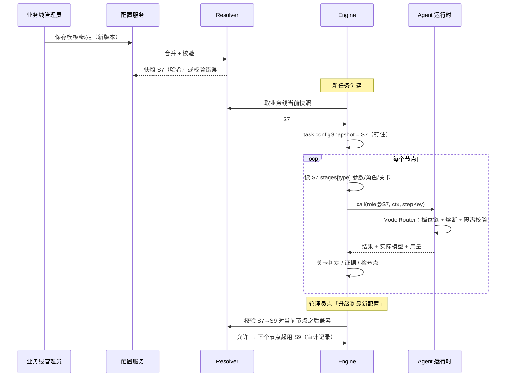

# 业务线流程 / 角色 / 模型配置设计（Pipeline Template + Model Config）

> 状态：设计稿 v2，未实现。分支 `codex/product-line-project-architecture`。
> v2 变化：从「全局模型配置」扩展为「全局目录 → 流程模板 → 业务线绑定 → 项目覆盖」四层，不同业务线可以有不同的角色、技能、流程节点和模型。

## 0. 结论先行

1. **四层配置，越往下能改的越少**：
   **全局目录**（角色、技能库、节点类型、模型档位） → **流程模板**（有序节点，每个节点绑 maker/checker 角色、关卡规则、自愈计划） → **业务线绑定**（选模板，增改角色、技能、节点参数、模型） → **项目覆盖**（只能改少量参数，且只能收紧）。
2. **节点类型固定，流程可裁剪**：确定性引擎只认识一组固定语义的节点类型，对应现在的 `core.Status`（`PRD_REVIEW / PLANNING / SPEC / DESIGN / DEV / QA / ACCEPTANCE / DELIVERED→RELEASED`，以及系统节点 `ANOMALY / DEGRADED / DISCARDED`）。模板可以**跳过可选节点、在节点里加检查、改参数**；第一期不支持新的节点类型。自定义能力通过「技能」和「节点内的附加检查（check hook）」提供。
3. **安全关卡不可删**：`PRD_REVIEW` 的硬规则（自治等级 `autonomy_allows`、禁区）、`QA`(CI)、验收评审、发布前治理（改动上限、冻结期、金丝雀、观察）是**锁定节点**，业务线只能收紧，不能删、不能放宽到全局下限以下。
4. **角色 = 技能 + 工具 + 输出 schema + 校验器 + 模型档位绑定**；maker/checker 隔离是全局硬规则，模板和业务线都绕不开。
5. **全部版本化，运行中的任务钉住版本**：任务创建时记录 `{templateId@v, lineBinding@v, modelConfig@v}`，之后只在**进入下一个节点时**才可选择升级（默认不升级），重放和审计永远按钉住的版本。
6. **调度仍由确定性引擎负责**，不引入 LLM 全局调度。模板只是引擎的输入数据，引擎负责校验、执行、自愈（v1 的模型兜底、熔断、`switch_model` 落地方案保持不变，见 §6）。

## 已确认决策（2026-10-15）

| # | 决策 | 结论 |
|---|---|---|
| 1 | 能否新增节点类型 | **1A**：第一期只能开关可选节点 SPEC / DESIGN；扩展通过节点内附加检查（check hook）实现 |
| 2 | 锁定节点范围 | **2A**：只有 SPEC、DESIGN 可关；INTAKE、PRD 评审、规划、开发、QA、验收、发布全部锁定 |
| 3 | 业务线私有模板 | **3B**：业务线私有模板需平台管理员审批后才能绑定 |
| 4 | 运行中任务升级配置 | **4A**：默认钉住快照不升级；「重新规划」/「重启」/自愈 replan 时默认升级到业务线最新快照 |
| 5 | 全局治理上限 | `maxChangeLinesCeiling = 3000`，`maxAutonomy = L3` |
| 6 | 页面与后端先后 | **6A**：后端先行，P1–P3 用 JSON 配置（API），页面在 P4 补上 |

## 1. 现状（代码依据）

| 位置 | 现状 | 对本设计的影响 |
|---|---|---|
| `core/Status.java` | 固定状态和转移表 `TRANSITIONS`；`PLANNING → SPEC / DESIGN / DEV` 已允许跳过 SPEC、DESIGN | 「可选节点」已有基础，直接复用 |
| `Engine.handle` 各状态分支 | 每个状态一段硬编码逻辑 | 变成「节点类型处理器」，从模板读参数 |
| `LlmAgents` / `Committee` | 角色硬编码：`prd.draft`、`plan.make`、`spec.write`、`design.make`、`dev.code`、`prd.*` / `accept.*` 评审 | 迁移为全局目录里的内置角色 |
| `Wiring.providers()` | 全局 `LLM_MODEL` / `LLM_CHEAP_MODEL` / `LLM_JUDGE_MODELS` | 迁移为模型档位（见 §8） |
| `Engine.healPlan` | 写死的 `plans` Map（`retry_same, switch_model, split, replan` 等） | 变成节点级 `heal` 配置，默认值等于现状 |
| 治理配置（`Governance.Release`：`maxChangeLines`、`sizeWeights`、`maxSplitParts` 等） | 全局 | 变成「全局下限 + 业务线收紧」 |
| `ProjectCfg` | `autonomy`、`PathRule`、`BudgetLimits`、`modules`、`discovery` | 项目覆盖层沿用这些字段 |
| `WorkflowOrchestrator` | 已预留 Temporal 适配；幂等键 `{task}:it{n}:{stage}:...` | 模板驱动不改变幂等键结构，只在任务里多存版本 |

## 2. 概念定义

| 概念 | 定义 | 由谁定义 | 例子 |
|---|---|---|---|
| **技能 Skill** | 可复用的指令片段 + 可选工具许可 + 可选文件模式规则，版本化 | 全局技能库；业务线可新增私有技能 | `i18n-json`（翻译键规范、按 locale 拆分文件）、`docs-style`、`java-spring`、`react-ts` |
| **角色 Role** | 一次 LLM（或规则）调用的完整规格：`kind`(maker/checker/advisor) + 基础提示词 + 技能列表 + 工具 + 输出 schema + 校验器 + 模型档位 | 全局内置角色；业务线可「派生」角色（继承 + 加技能 / 换档位） | `dev.code`，派生 `lms.dev.code` = `dev.code` + `i18n-json` |
| **节点类型 StageType** | 引擎里语义固定的一个状态处理器：输入/输出 schema、允许的转移、需要的证据、可绑的角色槽位 | 只能由代码定义（全局） | `DEV`：输入 Plan，输出 CodeChange + PR，证据 `pr`，槽位 `maker` |
| **节点 Stage** | 模板里对节点类型的一次使用：开关、绑定的角色、关卡阈值、重试上限、自愈计划、附加检查 | 流程模板 | `DESIGN: enabled=false` |
| **流程模板 PipelineTemplate** | 有序节点列表 + 关卡 + 自愈 + 预设，版本化 | 全局预设；业务线可复制改 | `web-fullstack`、`docs-only` |
| **业务线绑定 LineBinding** | 选一个模板@版本 + 覆盖 | 业务线 | `lms → web-fullstack@3` |
| **项目覆盖** | 受限覆盖：自治等级、路径风险、预算、模块命令、发现开关，只能收紧 | 项目 | `ProjectCfg` 现有字段 |

关系：`Stage(type) --slots--> Role --uses--> Skill*`，`Role --profile--> ModelProfile --chain--> Model*`。

### 节点类型清单（第一期）

| 节点类型 | 对应 `Status` | 可关闭 | 锁定的硬规则 | 角色槽位 |
|---|---|---|---|---|
| `INTAKE` | `BACKLOG` | 否 | 去重、信号来源可信度 | （可选）`discovery.triage` |
| `PRD_REVIEW` | `PRD_REVIEW` | 否 | 自治等级 `autonomy_allows`、禁区 | maker `prd.draft`；checker ≥2 + arbiter |
| `PLANNING` | `PLANNING` | 否 | 预算、改动量预估 | maker `plan.make` |
| `SPEC` | `SPEC` | **是** | — | maker `spec.write` |
| `DESIGN` | `DESIGN` | **是** | — | maker `design.make`；可选 checker `design.review` |
| `DEV` | `DEV` | 否 | 路径白名单、改动上限（可拆分） | maker `dev.code` / `dev.fix` |
| `QA` | `QA` | 否 | CI 必须通过；返修次数上限 | 附加检查（lint、i18n 键完整性等） |
| `ACCEPTANCE` | `ACCEPTANCE` | 否 | 验收评审 ≥2 席 + arbiter；用例覆盖 | checker `accept.*` |
| `RELEASE` | `DELIVERED→RELEASED` | 否（可设「只合并不发布」） | 冻结期、发布窗口、金丝雀、观察期 | 无 LLM |

`ANOMALY / DEGRADED / DISCARDED` 是系统节点，不出现在模板里，只能配置它们的自愈计划和上限。

**为什么第一期不支持自定义节点类型**：引擎的转移表、幂等键、证据链、看板统计都依赖固定语义。需要的扩展点（例如「安全扫描」「翻译完整性检查」）先做成某个节点里的**附加检查 check hook**（规则或 checker 角色），失败视为该节点失败。等确实有跨业务线的共性需求，再把它升级为新的内置节点类型（代码 + 版本迁移）。

## 3. 架构图

```mermaid
flowchart TB
  subgraph G["① 全局目录（平台管理员）"]
    ST[节点类型 StageType<br/>代码定义·语义固定]
    SK[技能库 Skill]
    RO[角色 Role<br/>skills+tools+schema+validator]
    MP[模型注册表 / 档位 Profile]
    GOV[治理下限<br/>锁定关卡·最低阈值]
    SK --> RO
    RO --> MP
  end
  subgraph T["② 流程模板（版本化）"]
    TP[web-fullstack@3 / docs-only@1<br/>节点开关·角色槽位·关卡·自愈]
  end
  subgraph L["③ 业务线绑定（版本化）"]
    LB[lms → web-fullstack@3<br/>+ 派生角色/私有技能/模型/参数]
  end
  subgraph P["④ 项目覆盖（只能收紧）"]
    PO[自治等级·路径风险·预算·模块命令]
  end
  ST --> TP
  RO --> TP
  GOV --> TP
  TP --> LB --> PO
  PO --> RES[解析器 Resolver<br/>合并 + 校验 → 生效配置快照]
  RES -->|快照 ID 钉到任务| ENG

  subgraph ENG["确定性引擎（唯一调度器）"]
    SM[状态机 Status<br/>节点处理器读快照]
    HEAL[异常巡查 / 自愈计划]
    CK[(检查点 stepKey·evidence·budget)]
    SM <--> HEAL
    SM <--> CK
  end
  SM -->|role + ctx| RT[Agent 运行时<br/>RoleSpec → ModelRouter → 熔断/兜底]
  RT --> PV[模型供应商 / RuleAgents]
  RT --> CK
```

## 4. 配置数据模型

所有对象都有 `id` + `version`，保存即生成新版本（不可变）。解析器把四层合并成一个**生效快照**（`effectiveConfig`，带内容哈希），任务只引用快照 ID。

```json
{
  "catalog": {
    "skills": {
      "i18n-json@2": { "instructions": "翻译文件按 locale 拆分到 src/locales/{lang}/*.json；只新增键不删键；键名与 en 对齐……", "filePatterns": ["src/locales/**"], "sizeWeightHint": "i18n" },
      "docs-style@1": { "instructions": "Markdown，中文，标题层级不超过 3……", "filePatterns": ["docs/**", "*.md"] },
      "react-ts@1":   { "instructions": "React + TypeScript 约定……", "tools": ["repo.read", "repo.search"] }
    },
    "roles": {
      "prd.draft@1":   { "kind": "maker",   "schema": "Prd",        "validator": "prd",        "profile": "reasoning" },
      "plan.make@1":   { "kind": "maker",   "schema": "Plan",       "validator": "plan",       "profile": "reasoning" },
      "spec.write@1":  { "kind": "maker",   "schema": "Cases",      "validator": "cases",      "profile": "general" },
      "design.make@1": { "kind": "maker",   "schema": "Design",     "validator": "design",     "profile": "general" },
      "dev.code@3":    { "kind": "maker",   "schema": "CodeChange", "validator": "codeChange", "profile": "coder", "tools": ["repo.read", "repo.search"] },
      "dev.fix@1":     { "kind": "maker",   "schema": "CodeChange", "validator": "codeChange", "profile": "coder" },
      "review.prd@1":  { "kind": "checker", "schema": "PrdVote",    "personas": ["value", "feasibility", "risk", "arbiter"] },
      "review.accept@1": { "kind": "checker", "schema": "AcceptVote", "personas": ["cases", "ux", "risk", "arbiter"] }
    },
    "profiles": {
      "fast":      { "chain": ["deepseek-chat"] },
      "general":   { "chain": ["deepseek-chat", "claude-sonnet"] },
      "reasoning": { "chain": ["deepseek-reasoner", "claude-sonnet"] },
      "coder":     { "chain": ["claude-sonnet", "deepseek-chat"], "requires": { "maxOutputTokens": 16000 } },
      "judges":    { "seats": [
        { "chain": ["deepseek-chat"], "temperature": 0.2 },
        { "chain": ["deepseek-reasoner"], "temperature": 0.0 },
        { "chain": ["claude-sonnet", "deepseek-chat"], "temperature": 0.7, "arbiter": true } ] }
    },
    "governanceFloor": {
      "lockedStages": ["INTAKE", "PRD_REVIEW", "PLANNING", "DEV", "QA", "ACCEPTANCE", "RELEASE"],
      "minJudgeSeats": 2, "maxChangeLinesCeiling": 3000, "maxAutonomy": "L3",
      "checkerMustDifferModel": true
    }
  },

  "templates": {
    "web-fullstack@3": {
      "stages": [
        { "type": "INTAKE" },
        { "type": "PRD_REVIEW", "maker": "prd.draft", "checker": "review.prd", "gate": { "pass": 0.7, "revise": 0.5 } },
        { "type": "PLANNING",   "maker": "plan.make" },
        { "type": "SPEC",       "enabled": true,  "maker": "spec.write" },
        { "type": "DESIGN",     "enabled": true,  "maker": "design.make" },
        { "type": "DEV",        "maker": "dev.code", "fixer": "dev.fix", "release": { "maxChangeLines": 800, "maxSplitParts": 4 } },
        { "type": "QA",         "maxLoops": 3, "checks": ["ci"] },
        { "type": "ACCEPTANCE", "checker": "review.accept", "gate": { "pass": 0.75, "revise": 0.5 } },
        { "type": "RELEASE",    "canary": true, "observeHours": 24 }
      ],
      "heal": {
        "default": ["retry_same", "retry_same", "switch_model", "replan"],
        "change_too_large": ["split", "replan"], "ci_flaky": ["rerun_ci", "replan"],
        "tool_down": ["trip_breaker", "wait_recover", "replan"], "merge_conflict": ["rebase_branch"],
        "maxHeals": 4
      }
    },
    "docs-only@1": {
      "stages": [
        { "type": "INTAKE" },
        { "type": "PRD_REVIEW", "maker": "prd.draft", "checker": "review.prd", "gate": { "pass": 0.65, "revise": 0.45 } },
        { "type": "PLANNING",   "maker": "plan.make" },
        { "type": "SPEC",       "enabled": false },
        { "type": "DESIGN",     "enabled": false },
        { "type": "DEV",        "maker": "dev.code", "release": { "maxChangeLines": 1500 } },
        { "type": "QA",         "maxLoops": 2, "checks": ["ci", "markdown-lint"] },
        { "type": "ACCEPTANCE", "checker": "review.accept", "judgeSeats": 2 },
        { "type": "RELEASE",    "canary": false, "observeHours": 0 }
      ],
      "heal": { "default": ["retry_same", "switch_model", "replan"], "maxHeals": 3 }
    }
  },

  "lines": {
    "lms": {
      "template": "web-fullstack@3",
      "roles": {
        "lms.dev.code": { "extends": "dev.code@3", "addSkills": ["i18n-json@2", "react-ts@1"] }
      },
      "stageOverrides": {
        "DEV": { "maker": "lms.dev.code", "release": { "sizeWeights": { "i18n": 0.1, "docs": 0.25 } } },
        "QA":  { "checks": ["ci", "i18n-keys-complete"] }
      },
      "models": { "coder": { "chain": ["claude-sonnet", "deepseek-chat"] } },
      "budget": { "monthlyUsd": 80 }
    },
    "handbook": {
      "template": "docs-only@1",
      "roles": {
        "handbook.dev.code": { "extends": "dev.code@3", "addSkills": ["docs-style@1"], "profile": "general" }
      },
      "stageOverrides": { "DEV": { "maker": "handbook.dev.code" } },
      "budget": { "monthlyUsd": 15 }
    }
  },

  "projects": {
    "lms/web": { "autonomy": "L2", "pathRules": [{ "prefix": "src/auth/", "level": "high" }], "budget": { "dailyUsd": 5 } }
  }
}
```

### 合并规则

- 合并顺序：目录默认 → 模板 → 业务线 → 项目；对象深合并，数组整体替换。
- **只能收紧的字段**（项目层对所有字段、业务线层对治理字段）：`autonomy`、`maxChangeLines`、`judgeSeats`、`gate.pass`、`observeHours`、`canary`。超出全局下限时保存报错。
- 业务线派生角色用 `extends`，只能加技能、换档位、追加指令，不能换 `kind`、`schema`、`validator`（保证节点间契约不变）。

## 5. 校验规则（保存时 + 解析快照时都跑）

1. **锁定节点**：`governanceFloor.lockedStages` 中的节点必须存在且 `enabled`；只有 `SPEC`、`DESIGN` 可关。
2. **顺序与转移**：节点顺序必须是 `Status.TRANSITIONS` 允许的路径；关掉 SPEC/DESIGN 时检查 `PLANNING → DEV` 转移存在（已存在）。
3. **schema 兼容**：上游节点输出 schema 必须满足下游输入（如 `ACCEPTANCE` 需要 `Cases`；关掉 SPEC 时，必须由 `plan.make` 输出验收条件或验收用例改由 PRD 生成，否则报错）。
4. **角色槽位**：每个节点槽位的角色 `kind` 要匹配（maker 槽不能放 checker）。
5. **maker/checker 隔离**：checker 档位每一席的首选模型不得等于其检查对象 maker 的首选模型；评审至少 `minJudgeSeats` 席且不全同模型；运行时再按任务实际用过的模型复核。
6. **证据完整**：每个锁定节点的必需证据（PRD 评审票、PR、CI 结果、验收票、发布记录）不可配置为关闭。
7. **能力约束**：角色 `requires`（输出上限、上下文）能被档位链中至少一个模型满足。
8. **引用完整**：所有 `@version` 引用存在；被运行中任务引用的版本禁止删除，只能归档。

## 6. 运行时：版本钉住、路由与故障恢复



- **钉住**：`Task` 增加 `configSnapshotId`；看板、重放、审计都按它解释。默认不自动升级；「重新规划 / 重启」时可选择是否升级到最新快照（默认升级，因为会从 `PLANNING` 重来）。
- **自愈**：`healPlan` 从快照的 `heal` 读取，默认值等于现在 `Engine` 里写死的 Map。`switch_model` 写 `TaskCtx.modelPins[role]`，兜底链、熔断、检查点续跑同 v1 方案。
- **调度**：仍是确定性引擎；模板只是数据。不引入 LLM 全局调度，可选的 `heal.advisor` 只给 replan/split 建议。

## 7. 现有硬编码 → 默认模板迁移

1. 把 `Engine` 各状态分支里的常量（评审阈值、`maxLoops`、`healPlan`、发布参数）抽到 `default@1` 模板，内容逐项等于现状；`Governance` 全局配置成为 `governanceFloor` + `default@1` 的默认值。
2. `LlmAgents` / `Committee` 的硬编码角色登记为目录内置角色（`prd.draft`、`plan.make`、`spec.write`、`design.make`、`dev.code`、`review.prd`、`review.accept`），提示词原文作为 `@1`。
3. 环境变量 → 模型档位：`LLM_MODEL` → `general/coder`，`LLM_CHEAP_MODEL` → 预算降级档位，`LLM_JUDGE_MODELS` → `judges.seats`（顺序、温度、`Wiring` 里的三段人设原样保留）。
4. 所有现有业务线绑定 `default@1`，现有任务回填 `configSnapshotId = S0`。
5. 验收标准：迁移后跑一遍现有 169 个后端测试 + live e2e 子集，行为和用量一致（对比 evidence 与 budget）。

## 8. 页面改动

**业务线详情页** 新增三个标签：

- **流程**：显示绑定的模板@版本；节点列表（锁定节点带锁图标，只显示可改参数）；可选节点开关；每个节点的角色槽位、关卡阈值、重试/自愈；「复制为业务线私有模板」。
- **角色**：本业务线生效的角色表（继承自目录 / 派生），可派生角色、加私有技能、预览拼接后的完整提示词。
- **模型**：每个角色实际生效的档位与兜底链、隔离校验结果、月度预算与近期花费。

**平台级「流程模板」页**：模板列表 + 编辑器（节点拖拽排序限于合法转移、校验实时报错）。

**通用能力**：
- **差异对比**：任意两个版本 / 快照的 diff（模板、角色、模型分区显示）。
- **生效预览**：选业务线 + 项目，展示合并后的生效快照，并标注每个值来自哪一层。
- **试运行（dry-run）**：选一个历史任务，用新快照只跑解析 + 校验 + 路由（不调模型或可选「影子调用」便宜模型），输出走哪些节点、每步用哪个模型、预计成本。
- **运行中任务**：任务详情显示钉住的快照，提供「下个节点起升级」按钮。

平台级「模型配置」页（供应商、模型注册表、档位）保留，作为全局目录的一部分。

## 9. 分阶段实施

| 阶段 | 内容 | 估时 |
|---|---|---|
| P1 目录 + 默认模板 | 数据模型、版本存储、Resolver（合并 + 校验规则 1–8）、硬编码抽成 `default@1`、任务钉快照；行为不变 | 3–4 天 |
| P2 模型路由 | 角色→档位→链、环境变量迁移、兜底/熔断、`switch_model` 落地、运行时隔离复核 | 2–3 天 |
| P3 业务线差异化 | 业务线绑定、派生角色、技能注入、可选节点开关、节点级 heal/阈值、check hook（i18n 键完整性、markdown-lint） | 3 天 |
| P4 页面 | 业务线「流程/角色/模型」标签、模板编辑器、diff、生效预览 | 3–4 天 |
| P5 运营能力 | dry-run / 影子调用、运行中任务升级快照、项目覆盖收紧校验、按业务线看板统计 | 2–3 天 |
| 以后 | 自定义节点类型、DAG 并行节点、Temporal 适配 | 视需求 |

合计约 13–17 天。P1+P2 完成后即可在后台用 JSON 给 `lms` 和文档业务线配不同流程，页面可后补。

## 10. 风险

- **配置爆炸 / 难排查**：四层合并后不清楚值从哪来。对策：生效预览标注来源层；快照哈希进证据。
- **业务线把流程配坏**：对策：锁定节点 + 只能收紧 + 保存前校验 + dry-run；业务线私有模板需平台管理员审批（可选）。
- **schema 不兼容**：关掉 SPEC 后验收没有用例。对策：校验规则 3；派生角色不能改 schema。
- **版本漂移**：长任务跑在旧快照上。对策：看板显示快照版本；旧快照只读归档不删除；重新规划时默认升级。
- **看板统计口径**：不同业务线节点集合不同，总览数字含义变化。对策：总览按节点类型聚合，关闭的节点显示为「跳过」。
- **技能提示词注入**：业务线私有技能是可编辑文本。对策：技能拼在系统提示里但不能覆盖 `Prompts.SAFETY`；技能改动进审计。
- **隔离与成本**（同 v1）：兜底可能破坏隔离或换到贵模型；运行时复核 + 预算降级。
- **改造面大**：`Engine` 各分支要改为读快照。对策：P1 先做「快照值 = 原常量」的纯重构，测试全绿后再开放差异化。

## 11. 实施记录（2026-10-15）

| 阶段 | 提交 | 内容 |
|---|---|---|
| P1 | `b455b39`、`2823f5f` | `pipeline` 包：目录（节点类型 / 内置角色 / 技能 / 模板 `default@1`、`web-fullstack@1`、`docs-only@1`）、校验器、解析器、`config_snapshot` 表；任务创建钉住快照，重新规划 / 重启 / 自愈 replan 升级到最新；自愈计划、SPEC/DESIGN 开关、阈值、QA 返修上限改从快照读取。`default@1` 全部参数为 null，沿用治理配置，行为不变。API：`/api/pipeline/*` |
| P2 | `1c5a726` | `ModelRouter`：角色 → 档位 → 候选链，每模型熔断，失败调用用量累加；`switch_model` 写 `TaskCtx.modelPins`；评审席位优先避开本任务执行方用过的模型；无保存配置时从 `LLM_*` 迁移（与改造前等价）。API：`GET/PUT /api/pipeline/models` |
| P3 | `0dc8b04` | 业务线派生角色（`extendsRole`）+ 技能注入提示词（排在安全规则之前）；业务线按角色选档位；QA 附加检查 `i18n-keys-complete`、`markdown-lint`；模板 `DEV.maxChangeLines` |
| P4 | `5631ea2` | 前端：产品线详情「流程 / 角色与技能 / 模型」标签（实时预览 + 差异）；「模型与流程模板」页（模型配置 JSON 编辑、模板复制 / 提交 / 审批） |
| P5 | 见 git log | 试运行（dry-run，不调模型）；运行中任务手动「升级到最新配置」；看板按业务线标注跳过的节点 |

与设计的差异：
- 运行时隔离复核只做「优先避开」：席位候选全被执行方用过时仍按配置调用（与改造前一致），不弃权。
- 平台管理员由 `X7_PLATFORM_ADMINS` 指定；未设置时无人获得平台管理员权限；工作区私有模板仍按工作区角色审批。
- 自治上限 L3 由已有的 `LineRepo.validateAutonomy`（只允许 L1–L3）保证，未新增字段。
- `review.design` 槽位已登记，设计评审仍用评审席位 1。
