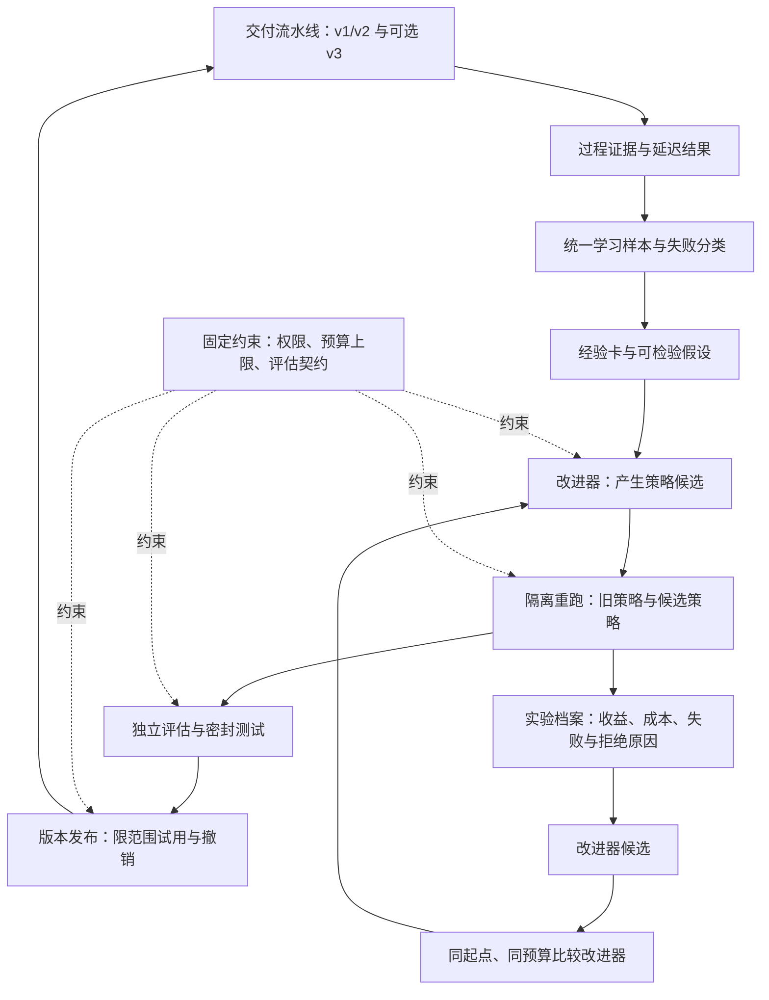

# x7x24：基于过程证据的递归自我改进设计

调研日期：2026-10-28。状态：阶段 A/B 的后端最小闭环已实现，运行方式与覆盖边界见 [学习闭环使用说明](../learning.md)。第二层递归改进仍为设计提案。

本方案依据调研时工作区源码及迁移文件，而非仅依据 README。实现保留工作区原有业务改动，只在学习模块与必要接入点增补代码。尚未读取运行数据库、统计真实样本量或执行真实模型改进实验；“已有表/记录能力”不等于“已有足够、完整、可复现的数据”。论文与官方实现的调研见 [一手资料记录](../rsi-primary-sources.md)。

## 1. 设计判断

建议建设一个**受约束、可验证的系统级自我改进闭环**，先演进角色指令、技能和上下文选择，再演进产生这些改进的方法。近期不以模型权重训练为起点。

第一层提升任务 agent 的交付能力：减少重复失败、提高独立验收通过率、降低获得一次有效交付的总成本。第二层提升改进 agent 的研究效率：在相同初始版本和实验预算下，更快找到可以在新任务上复现的改进。

不能用“日志更多”“经验库更大”“最终版本更强”直接证明递归自我改进。只有第二层也得到独立对照支持，才报告“改进机制得到了改进”。持续改进也不意味着无限、自加速或每轮必然提升。

## 2. agent 实际如何进行自我改进

| 路线 | 持久变化的对象 | 反馈与机制 | 对本项目的用途 |
| --- | --- | --- | --- |
| 反思记忆：Reflexion | 失败反思、后续任务可读的经验 | 执行反馈转成文字，下一次执行检索使用；不更新模型权重 | 任务内返修与跨任务失败经验 |
| 技能积累：Voyager | 可复用技能代码与技能库 | 执行、修正、验证、入库，再组合使用 | 将验证过的操作方法沉淀成有适用条件的技能 |
| 上下文演进：ACE | 条目化经验手册 | Generator、Reflector、Curator 分工，增量更新和去重 | 避免把整段日志不断追加到系统提示 |
| 反思优化：GEPA | 文本组件，如指令、提示或配置 | 执行轨迹与评分用于生成变异；保留对不同样本有效的候选 | 优化角色/技能指令；实验执行与评分仍由项目提供 |
| agent 程序搜索：DGM、ADAS | 工具使用、控制流程或 agent 程序 | 生成候选，执行评估，保留有价值的版本或档案 | 后期优化上下文构建、规划和工具策略 |
| 元层演进：Hyperagents、Skill∞ | 任务 agent 以及产生改进的方法 | 改进器本身成为可修改、可评估对象 | 第二层：故障归因、候选生成、样本选择与实验资源分配 |

来源：[Reflexion](https://arxiv.org/abs/2303.11366)、[Voyager](https://arxiv.org/abs/2305.16291)、[ACE](https://arxiv.org/abs/2510.04618)、[GEPA](https://arxiv.org/abs/2507.19457)、[DGM](https://arxiv.org/abs/2505.22954)、[ADAS](https://arxiv.org/abs/2408.08435)、[Hyperagents](https://arxiv.org/abs/2603.19461)、[Skill∞](https://arxiv.org/abs/2610.35434)。这些工作支持不同范围的实验结论，不代表已经证明生产环境下无限递归提升。

近期研究也说明需要克制解释。2026-09 的 AIDE² 展示了 agent 修改自身代码、在隐藏评估中选择版本；但其比较改进器的 ignition test 未得出确定结论。2026-10-20 的评测审计强调：应将“最终系统更好”与“改进程序更好”分开验证。2026-10-26 的 Skill∞ 将优化方法本身封装成 meta-skill，路线适合本项目已有技能体系，但仍是非常新的预印本。[AIDE²](https://arxiv.org/abs/2609.26457)、[评测审计](https://arxiv.org/abs/2610.27610)、[Skill∞](https://arxiv.org/abs/2610.35434)。

工程选择：借鉴 ACE 的增量经验管理、GEPA 的反思候选生成、DGM 的版本档案及 Hyperagents/Skill∞ 的元层结构；验证服务、权限与发布规则由程序执行。此组合是本项目设计判断，不是某篇论文已经验证过的完整实现。

## 3. 当前项目的基础与缺口

| 已有机制 | 已核对的落点 | 可以复用的部分 | 需要补齐的部分 |
| --- | --- | --- | --- |
| 生命周期、返修与节点记录 | `Engine`、`StageExecutions`、`task_event`、`stage_execution` | 执行次序、返修边、时间与阶段成本 | 统一的根任务/尝试关联；旧证据部分按时间窗口查询，不能当作精确因果关联 |
| 内容证据与评审 | `EvidenceStore`、`VerdictStore`、`CodeReview`、`ui_acceptance_run` | 补丁、失败、评审发现与逐项验收 | 检查对象的提交版本、执行器与证据强度；延迟缺陷标签 |
| 成本与调用状态 | `BudgetService`、`ModelCalls`、`agent_job` | Token、金额、CI 分钟、模型/角色/尝试信息 | 实验级成本归集、估算/实账标记；调用日志可能缺失，需记录完整度 |
| typed workflow | V23/V25/V27、`WorkflowStore`、`WorkflowScheduler` | 固定产物版本、依赖、输入指纹、节点执行与结果清单 | schema3 是独立可选路径，不能假定全部历史任务都有这些数据 |
| 上下文清单 | `ContextBuilder`、`context_manifest` | 哪些输入被包含或因预算省略，以及摘要 | 未来还要记录经验检索及策略选择，不能仅记录输入总量 |
| 角色与技能锁定 | `RoleSnapshotResolver`、`SkillResolver`、`PipelineService` | 技能版本、依赖、参数、作用域、指令摘要 | 一个包含策略、上下文选择和实验来源的完整行为版本 |
| 技能撤销 | `SkillReleases`、`skill_release_revocation` | 已撤销版本在执行时失效 | 候选评估、发布范围、试用指标和版本效果档案 |

必须保留的三个语义区分：

1. `skill_evaluation` 当前记录 `INSTRUCTIONS_LOADED_ONLY`，评估技能适用性、能力条件和撤销状态；它不是技能收益评估。见 [LegacyJsonDispatcher](../../apps/server-java/src/main/java/com/x7x24/workflow/LegacyJsonDispatcher.java)。
2. `WorkflowRuntime` 的 `SUCCEEDED` 表示合同产物已生成；`LegacyJsonDispatcher` 返回的补丁可以带 `testEvidence=UNKNOWN`。它们不能直接标记成任务成功。见 [WorkflowRuntime](../../apps/server-java/src/main/java/com/x7x24/workflow/WorkflowRuntime.java)。
3. `LocalFileDispatcher` 明确只执行文件断言，返回 `projectTestExecution=false`、`businessValidation=UNKNOWN`；不是完整项目测试或业务验收器。见 [LocalFileDispatcher](../../apps/server-java/src/main/java/com/x7x24/workflow/LocalFileDispatcher.java)。

此外，[AgentTimeline](../../apps/server-java/src/main/java/com/x7x24/execution/agent/AgentTimeline.java) 为展示而截断、合并和限频。界面时间线适合诊断摘要，不等于完整可重放轨迹。哈希证明内容一致，也不证明内容判断正确。

## 4. 首先把过程记录变成可学习样本

### 4.1 样本单位与身份

采用“两层样本”：节点尝试 episode 用于定位可改进环节，完整交付任务用于衡量最终收益。不同返修尝试归属于同一根任务，不能作为独立任务计数，也不能拆到不同数据集合。

episode 固定记录：

- 身份：workspace、project、rootTask、task、pipelineVersion、planRevision、node、role、run、attempt、parentRun，以及显式关联的输入、输出和证据 ID。
- 执行基线：repo/baseSha、实际 patch/headSha 或 treeDigest、环境镜像与依赖锁摘要、工具版本、可用能力。
- 行为版本：policyVersion、角色/技能锁、上下文选择策略、实际注入的经验版本及摘要、模型路由摘要与实际报告模型、关键推理参数。
- 过程观察：结构化工具调用、错误指纹、变更摘要、检查结果、耗时和成本；记录是否截断、脱敏、缺失，以及可重放程度。
- 结果：结果类别、来源、被检查对象的 digest/SHA、观察时间与标签版本。

不要求采集模型私有思维链；学习依靠输入、行动、可观察输出与外部反馈。模型返回的诊断文字属于待验证解释。

### 4.2 结果采用多维标签

分别记录 `executionOutcome`、`testOutcome`、`acceptanceOutcome`、`deliveryOutcome`、`delayedOutcome`，每项均允许 `UNKNOWN`。例如“代码已生成 / 未运行测试 / 未业务验收 / 尚未交付”是合法记录，不得压成一个成功布尔值。

结果可信度按来源标记：

- 可复现的独立测试/明确断言是主要反馈，但只能支持其声明范围。
- 固定 rubric 的业务验收、代码评审与人工纠正是补充反馈；LLM 评审票数不自动等于独立客观事实。
- GitHub 合并和 Release 是交付事件，不代表已经生产部署或完成生产健康验证。
- 回滚、同缺陷再次出现、后续纠正属于延迟反馈。观察窗可先设为 7 天并按项目调整，未满窗口为未成熟标签，不能当作“没有缺陷”。

基础设施故障、主动取消、预算中止、权限阻塞和业务失败分别归类。将同一错误重复出现与后续成功的修复组成对照材料，但历史对照只产生假设，不能直接证明修复方法的因果收益。

### 4.3 经验卡的最小结构

每条经验包括：适用技术栈/节点/错误特征、前提、建议动作、可验证的预期、证据引用、反例、置信依据、版本、失效条件。举例是“出现某类构建错误时先核对指定版本的依赖与编译配置”，不是“以后多注意构建”。

经验生命周期为 `PROPOSED → VERIFIED → ACTIVE → STALE/RETRACTED`。一次成功只形成提案；独立重跑支持后才可以激活。使用次数、成功关联次数与受控实验贡献分别统计，不用相关性计数替代因果评价。合并重复条目、保留冲突与反例、按项目版本淘汰过期经验；不得无限追加整本手册。

v1/v2 与 v3 各自通过适配器投影到相同 episode 结构。旧记录缺失内容保持 UNKNOWN，不能回填虚构的模型、策略或提交版本。第一阶段无需全量迁移到 v3。

## 5. 学习什么，以及谁负责

### 5.1 第一层：任务行为版本

定义不可变 `PolicyVersion`，它可以包含角色指令片段、技能包版本、经验检索配置、允许调整的上下文排序参数及可选步骤偏好。每个候选带父版本、修改 diff、预期改进、适用条件、来源 episode、验证方法和总代价上限。

优先次序：

1. `dev.fix` 的失败诊断、文件定位与修复步骤。
2. 上下文检索与材料排序；必需输入仍由确定性规则保留，不能因优化而被删除。
3. 规划拆分与选取已有目录节点的策略。
4. 任务内模型路由，仅在模型、价格与公平评测均可追踪后开展，避免把换更强模型误判为策略收益。
5. 低风险的工具控制或运行代码变更，在完整隔离评估成熟后再纳入。

评审模型也可以以后优化，但不能与 maker 在同一轮共同变动。否则“更容易被评审通过”与“实现更好”无法区分。

### 5.2 第二层：改进器版本

将改进器拆成可版本化的方法：错误聚类/归因提示、候选生成 meta-skill、样本选择、候选选择及实验预算的分配策略。它读取实验档案，提出下一版改进方法。

改进器可分配已给定的实验预算，不能增加硬上限，也不能修改密封测试、正确性标准、权限或发布阈值。生成者和评估者通过服务权限和数据访问隔离；分角色提示和不同模型只是额外措施。

第二层需要实验档案自身的数据：哪类假设最终有效、哪些候选只是记住样例、哪种证据更有区分力、每次尝试的完整成本、候选被拒绝的原因。只复用交付日志，不记录改进过程，就缺少第二层的学习材料。

### 5.3 组件边界

建议后端新增 `learning/` 模块，先在现有应用内作为独立作业运行：

| 组件 | 输入 → 输出 | 边界 |
| --- | --- | --- |
| `EpisodeProjector` | 事件/运行/产物/结果 → 标准 episode | 只读原证据、幂等投影；不改变任务状态 |
| `ExperienceCurator` | 样本与反例 → 经验提案 | 提案不能自行成为有效规则 |
| `CandidateGenerator` | 经验、失败群、父策略 → 候选版本 | 只修改显式允许的策略组件 |
| `ExperimentRunner` | 候选、固定用例、预算 → 实验运行 | 独立工作目录与运行资源，不调用真实交付写接口 |
| `EvaluationService` | 实验产物与固定评测契约 → 分项评分/证据 | 对候选和改进器只读；密封结果受访问控制 |
| `ReleaseManager` | 评测证据 → 小范围生效/回退/撤销 | 按固定政策裁决，记录发布和分流对象 |

复用现有审计、预算、租户与暂停机制。不要把实验直接塞进 `Engine` 的业务状态分支，也不要把当前 `workflow_candidate` 复用为改进候选：它代表任务工作流提案，两者的生命周期和评估对象不同。

GEPA 可作为可替换的离线候选优化器。官方自定义 adapter 由接入方提供执行评分及反思材料，因此它不会替本项目提供可靠验收。若使用 Python 优化作业，Java 继续掌握样本权限、执行、评分和发布；通过内部 JSON 契约交换摘要与候选。也可以先实现少量候选的简单反思搜索，不必为接入算法改写业务运行时。[GEPA adapter 官方文档](https://gepa-ai.github.io/gepa/guides/adapters)、[预算配置](https://gepa-ai.github.io/gepa/api/optimize_anything/EngineConfig)。已通过 Context7 核对。

### 5.4 数据模型增量

建议按阶段新增以下领域实体，物理表不必一次建齐：

| 实体 | 关键关系 |
| --- | --- |
| `learning_episode` | 原始 task/run/evidence 引用、基线、行为摘要、完整度 |
| `learning_outcome` | episode/任务的追加式结果观察，来源、观察时点、成熟度 |
| `experience_card` | 内容版本、适用范围、证据、反例与状态 |
| `policy_version` | kind=task/improver、父版本、组件内容、摘要与适用域 |
| `improvement_candidate` | 父策略、假设、diff、生成者版本、允许修改范围 |
| `evaluation_suite` / `evaluation_case` | 分组后的数据切分、固定测试与环境、用例版本/摘要 |
| `improvement_experiment` / `experiment_arm` | baseline/candidate 或旧/新 improver、重复、成本、结果与证据 |
| `policy_release` | 范围、选中版本、分流、晋级依据、回退目标、撤销事件 |

所有实体带 workspace，项目私有实体还带 project；关联证据与查询都执行相同作用域检查。跨项目提炼只在授权范围内生成去业务化经验，跨租户不默认共享。评测集中的隐藏内容还需要独立权限，普通工作区可读不等于优化器可读。

## 6. 如何证明改进有效

### 6.1 从历史任务构建可重跑的用例

每个用例固定“尝试前”的代码状态、需求和验收契约、依赖与运行环境。历史修复后的代码/答案不提供给候选。任务拆分、同 Issue 的返修和近重复故障按根任务/问题族分组，结合时间切分；不能随机把同一故障的几次尝试拆进训练和测试。

样本分为：用于反思和生成候选的发现集；用于选择候选的验证集；用于最后晋级的密封测试集。验证集经多轮搜索后也会过拟合，不能再作为“未见任务”的证明。密封测试不能持续返回逐例解释给优化器；用过的测试窗口逐步轮换，泄露的用例退出密封集。

当前项目还需要补充完整的实验执行能力：在固定仓库 checkout 上应用补丁，运行项目实际构建/测试，再执行独立验收。`LocalFileDispatcher` 只能承担它支持的声明式文件断言。新 runner 的隔离资源和队列应与交付 runner 分开；现有 runner 默认一次一个 job，不能假定可直接承载并发实验。

实验没有生产写凭据，不创建/合并远端 PR、不发布。需要外部工具时使用固定响应夹具或受控测试服务；只重放旧日志无法衡量新策略会如何行动。依赖、环境不可恢复的旧任务仅用于诊断，不能装成可复现实验。

### 6.2 指标采用分层裁决

先检查不可妥协的条件，再比较质量和效率：

1. 硬约束：未改评测/已有测试来规避问题，未违反路径/权限/租户/网络约束，所需验证证据完整。
2. 主要效果：独立验收通过率、首次有效修复率、完整任务的有效交付率；发布后的观察标签成熟后再计入延迟缺陷。
3. 效率：每个成功任务的总成本、平均返修数、总运行时间与尾部时间。不能只统计成功样本的执行成本，失败与被放弃的尝试仍计入分子。
4. 学习投入：生成、反思、所有候选评测和试用的成本；单独报告，最终计算收益是否覆盖投入。

若采用单一搜索分数，只将它用于候选排序；晋级仍检查上述分项。不能用若干加权分抵消一个权限违规或核心用例失败。

旧策略与候选在相同用例、模型和预算上做成对比较，随机化执行顺序，必要时重复运行；模型端点变化和依赖漂移均记录。报告置信区间及项目/节点/错误族分层结果，样本少则保持“证据不足”。若允许更大算力，额外报告预算相等的对照。

小样本 MVP 的 20–50 个可重跑用例仅用于发现流程问题和形成初步收益估计，不足以自动证明几个百分点的普遍改善。正式晋级样本量由基线通过率、波动及最小有意义改善决定，不机械套一个固定数量。

### 6.3 为递归性单独做实验

将初始任务策略 P0、评测任务族、基础模型与实验预算固定，分别让初版改进器 I0 与新版 I1 从同一个 P0 开始。清理两组相互可见的搜索缓存/记忆；改进器版本自身携带的内容计入被比较对象，并排除测试污染。

比较：找到第一个通过密封验证的有效候选所需成本、预算内有效候选数、固定预算下最佳候选在新任务上的表现、完整循环多次独立运行的方差，以及迁移到新项目/错误族后的收益。也比较与简单随机候选/固定反思流程的同预算基线。

只有任务策略提升，就报告“任务能力自我改进”；I1 在这些对照上也有证据支持，才报告“改进器自我改进”。不成立时保留 I0，继续记录失败实验。[评测审计](https://arxiv.org/abs/2610.27610)、[AIDE²](https://arxiv.org/abs/2609.26457)。

## 7. 如何进入现有运行系统

采用“新增版本、按范围发布、执行前固定”的方式，避免生成者直接修改全局提示。

- 候选状态：`DRAFT → EVALUATING → REJECTED/ELIGIBLE`。符合发布条件后独立建立 `policy_release`，依次为 `SHADOW → CANARY → ACTIVE`，退化时 `ROLLED_BACK/REVOKED`。
- SHADOW 在隔离环境中对照；CANARY 按任务稳定分配少量符合条件的新任务，比例可从 5% 起且由样本量和预算调整。一次任务内固定同一版本，避免每轮返修换策略而失去可解释性。
- 发布新技能内容到现有版本体系时做显式映射；当前目录的整数技能版本与 `SkillResolver` 三段版本表示不同，不能直接假定兼容外部 skill 包格式。
- 新增任务创建时选择策略和经验版本，保存进角色/技能/上下文锁。运行中只能读取已固定版本，同时即时执行撤销、权限收紧和预算检查。
- 当前 `LegacyJsonDispatcher` 会重新核对角色与模型配置，变化可能触发 `ROLE_CONFIGURATION_CHANGED`。实现时需区分“新任务解析发布策略”和“旧任务验证固定版本”；不能靠替换全局角色配置来灰度发布。
- `RoleSnapshotResolver`、`PipelineService` 和 `ContextBuilder` 是未来接入点；v1/v2 与 v3 分开接入，保持原任务路由。治理变化仍按现有机制阻塞或要求新计划，不能被版本固定绕过。
- 回退先停止新分配，再撤销有问题的版本；对在途执行在下一个允许的边界停止/恢复，不谎称能抹去已发生的外部影响。回退目标自身也需通过当前撤销和权限检查。

已授权范围内、通过固定评测门槛的指令/经验更新可以自动发布；涉及治理规则、工具权限、评测标准或运行器代码的变更按现有权限与合并政策处理。是否需要人确认由项目政策决定，不给每一次低风险学习增加人工节点，也不允许改进器自行放宽门槛。

## 8. 建议的最小闭环与阶段验收

### 阶段 A：可相信的数据

新增 episode 投影和结果分类，盘点各项目可重跑样本、标签成熟度及缺失项。优先选择一个有确定性测试的项目和一种错误族；候选可以是编译失败、缺失导入或错误定位，但必须由实际分布决定，不能假定历史中哪一类最多。

验收：从一个失败任务能追溯到执行前代码、失败检查、修复补丁、实际注入策略和后续检查；缺数据明确显示。按根任务去重并成功重跑一批基准用例。此阶段不声称提升效果。

### 阶段 B：第一层学习 MVP

只优化 `dev.fix` 的一个技能/指令组件。先整理 20–50 个可重跑用例做可行性实验，形成失败→假设→3–5 个候选→对照重跑→密封验证→小范围试用的流程。每轮候选数量是起步的资源限制，不是统计充分性证明。

验收：每个候选都有来源、diff、基线、可比成本和独立证据；无收益或证据不足的候选会被拒绝；激活后能追踪实际使用任务并撤销。没有完整项目测试能力前，只能发布对已有断言范围有效的结论。

### 阶段 C：扩展任务行为

按收益证据扩展到上下文排序、经验检索和任务规划。保留基线版本，分别比较“无新经验”“只检索经验”“固定反思搜索”“优化后的策略”，区分数据收益、方法收益和模型升级收益。

验收：收益可在新的问题族或时间窗口复现，且质量、成本、时长的分项结果可解释。试用阶段延迟质量标签未成熟时，不提前宣布全量成功。

### 阶段 D：第二层递归改进

实验档案足够丰富后，才优化候选生成 meta-skill、样本选择和实验分配；执行第 6.3 节的同起点、同预算对照。

验收：新改进器在多个独立起点/任务族上的研究效率有可信提升，评估及权限没有同时放宽。达不到则只保留第一层，不把增加 meta agent 当作完成 RSI。

不先承诺开发周数：需要先知道运行数据量、项目环境可重建程度和 runner 资源。若样本很少，先做记录与小范围人工核对，不启动高成本连续搜索；MVP 可按完成样本数量或同类故障频率触发，避免每一次任务结束都运行完整进化。

## 9. 运行约束与产品呈现

学习数据沿用 [数据策略](../data-policy.md)：审计/证据的脱敏不是匿名化，日志可能仍有个人或业务信息。经验提炼遵守原仓库和模型外发授权，评估隔离不能获得生产密钥。敏感原始证据保留在受控存储，学习产物保存必要摘要和引用，并为派生经验设置失效/撤回流程。

学习预算与交付预算分开归集，但合计受相同项目、产品线和全局上限约束。先固定每轮候选数、评测数、费用和最长时间，达到任一限制即停止。没有新证据、长期无收益或反复回归时暂停新搜索并保留现有有效版本。

产品中增加“改进记录”视图即可：展示失败模式、候选差异、适用范围、基准与候选的质量/成本/时长、测试覆盖范围、实际试用样本、标签成熟度、当前版本和回退记录。任务详情显示“本次使用了哪些经验和策略、为什么适用”；不展示一个无法审计的“智能提升百分比”。

本次推荐实施边界是阶段 A + B：先让一种可复现失败转化为一次有证据的行为改进，再扩大范围。完整 RSI 的第二层已在设计中给出入口和证明标准，尚不能以设计文档本身视为实现。
