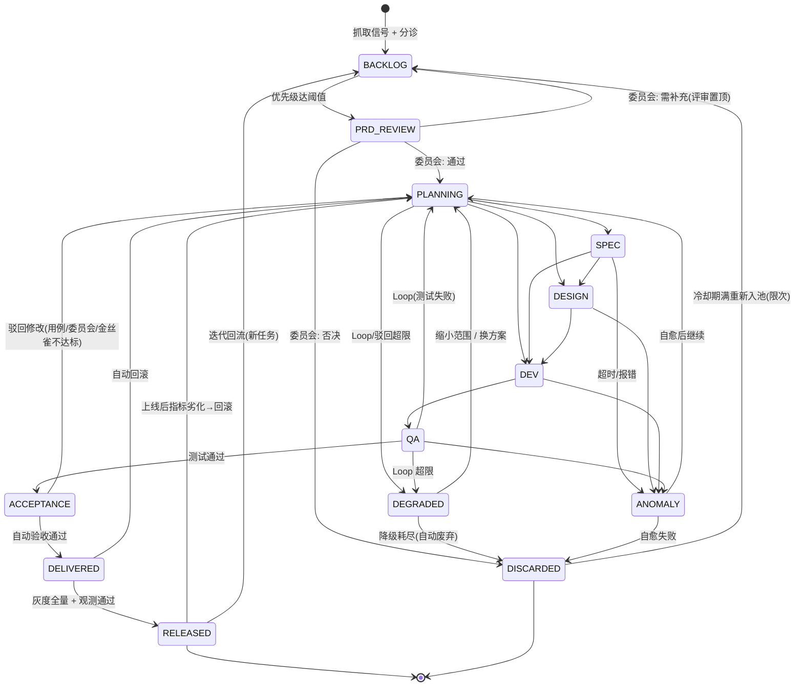
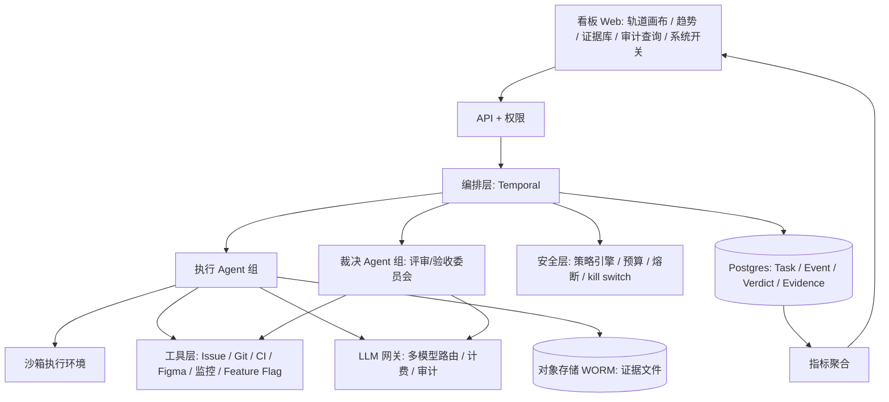
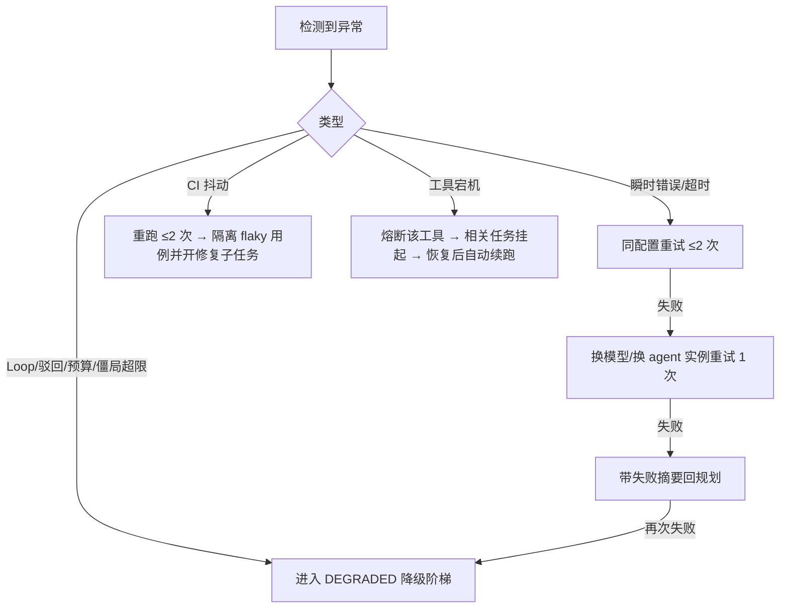

# 7x24 · 持续产品交付 Agent 工作流 —— 设计拆解与开发方案（全自治版）

> 版本：v0.2（全自治版）｜日期：2026-10-11｜依据：用户提供的看板截图
> 变更说明（相对 v0.1）：按用户要求，**流程里不再有人工 gate**。图中两个菱形节点（◇PRD 评审、◇业务验收）改为 **agent 自动裁决**；Loop 超限后不转人工，改为**自动降级**；另外补充第 6 章「自治安全机制」。
> 说明：截图中字太小、无法辨认的文字统一标为 **「图中不清晰」**，不做猜测。标为 **「推断」** 的内容来自图中数字之间的关系，需用户确认。

---

## 0. 一页结论

- 这张图本质上是一个 **「需求 → 交付 → 上线 → 再迭代」的状态机看板**：每张卡片是一个状态（数字 = 当前停在该状态的任务数），每条箭头是一次状态迁移，虚线表示回流、废弃或循环。
- **全自治**：两个菱形 gate 由 **评审委员会（多 agent 投票）+ 硬规则 + 评分阈值** 自动裁决。业务验收依据「验收用例自动执行 + 预发环境验证 + 线上金丝雀指标校验」。全程没有人工审批节点。
- **没有人兜底，安全全靠系统**：最小权限 + 沙箱、预算上限、发布前自动检查、灰度 + 自动回滚、kill switch（只作系统保护）、不可篡改的审计与证据链、评审与执行隔离（用不同模型和提示）、异常巡查自愈。
- 编排层选 **Temporal**：它提供持久化状态机、定时调度、超时与重试、宕机恢复，适合 7x24 无人值守。
- 分期：**MVP（3 周）** 在单产品线跑通全自动闭环（只做低风险变更）；**V1** 补全三路执行、委员会裁决、金丝雀验收、自愈巡查；**V2** 扩到多产品线，加自适应风险分级和自治度量。

---

## 1. 图的解读

### 1.1 页面结构

| 区域 | 图中内容 |
|---|---|
| 顶栏 | Logo + `7x24`「持续产品交付」；`产品线` 下拉（当前为「全部产品」）；日期范围 `09-01 - 09-30`；右侧一排图标按钮，其中一个带角标数字，含义图中不清晰 |
| 主画布 | 外框「7x24 · 交付轨道」，右上角 **168**（下方小字图中不清晰）。内含两个泳道：「Watch · 任务发现」**66**、「Prism · 任务执行」**67**（两处数字下方的小字图中不清晰） |
| 画布工具条 | 全屏、适应、定位、缩小、放大等画布操作按钮 |
| 底部说明行 | 一排约 6 组小字。能辨认的标题大致是「专业协作 / 能力底座 / 执行路径 / 运行治理 / ……」；后两组标题和每组下面的说明 **图中不清晰**（用户提到的「技能边界、风险决策」暂按用户描述记录） |
| 底部看板 | ①「近 30 日交付趋势」：新增 168 · 交付 27，折线图有实线、虚线两条，横轴 9/1 ~ 9/30；②「迭代闭环」：**27 次迭代**，「16% 形成生产交付」，环形进度；③「成果沉淀」：**359 份证据**，「27 项生产交付 · 0% 验收重盘」（「重盘」二字以用户描述为准） |

### 1.2 节点清单与全自治改造

| # | 节点 | 泳道 | 图中计数 | 图中形态 | **本方案执行方式** |
|---|---|---|---|---|---|
| N0 | 全部产品 | 入口 | 168 | 汇总 | 系统汇总 |
| N1 | 抓取信号 | Watch | — | 普通节点 | 信号 agent（定时） |
| N2 | 需求池 | Watch | 66 | 普通节点 | 分诊 agent |
| N3 | PRD 评审 | 交界 | — | ◇ 菱形 | **PRD 评审委员会自动裁决** |
| N4 | 任务规划 | Prism | 3 | 普通节点 | 规划 agent |
| N5 | 需求策划（PRD） | Prism | 4 | 普通节点 | 策划 agent |
| N6 | 体验设计 | Prism | 0 | 普通节点 | 设计 agent + 设计评审 agent |
| N7 | 开发执行 | Prism | 0 | 普通节点 | 开发 agent |
| N8 | 质量测试 | Prism | 7 | 普通节点 | 测试 agent + CI |
| N9 | 业务验收 | Prism | 21 | ◇ 菱形 | **验收委员会 + 金丝雀指标自动裁决** |
| N10 | 交付未上线 | 外框 | 8 | 普通节点 | 发布 agent（灰度中 / 等发布窗口） |
| N11 | 已上线 | 终态 | 27 | 高亮 | 观测 agent |
| S1 | 已废弃 | Watch | 5 | 终态 | 系统（记录原因） |
| S2 | 异常巡查 | Prism 旁路 | 32 | 普通节点 | 巡查 / 自愈 agent |

**数字关系（推断）：**
- Prism 67 = 3 + 4 + 0 + 0 + 7 + 21 + 32 ✔
- 外框 168 = 66 + 67 + 8 + 27 ✔（已废弃的 5 个不计入）
- 16% ≈ 27 / 168

结论：节点上的数字是 **当前快照**；异常巡查也会持有任务。

### 1.3 迁移（边）清单

| 边 | 从 → 到 | 图中标签 | 全自治实现 |
|---|---|---|---|
| E1 | 全部产品 → 抓取信号 → 需求池 | — | 定时抓取、去重、聚类 |
| E2 | 需求池 → PRD 评审 | — | 优先级分 ≥ 阈值时自动提交 |
| E3 | PRD 评审 → 需求池 | 「评审置顶」（字小，也可能是「评审意见」） | 委员会判定「需补充」→ 带意见退回需求池，提升排序后重写 PRD |
| E4 | PRD 评审 → 已废弃 | 「废弃」 | 委员会判定否决（原因枚举） |
| E5 | PRD 评审 → 任务规划 | — | 委员会通过 |
| E6 | 任务规划 → 策划 / 设计 / 开发 | 虚线三分叉 | 按路径分派 |
| E7 | 开发 → 测试 → 业务验收 | — | 自动 |
| E8 | 测试 → 任务规划 | 「24 次 Loop」 | 测试失败后重规划 |
| E9 | 执行阶段 ↔ 异常巡查 | 「处理后继续」 | 巡查自愈后回到流程 |
| E10 | 业务验收 → 任务规划 | 「驳回修改」 | 验收委员会或金丝雀判定不达标 → 带原因重规划 |
| E11 | 业务验收 → 交付未上线 → 已上线 | — | 全量发布并观测通过 |
| E12/E13 | 执行期 / 后段 → 已废弃 | 「废弃」「主动废弃」 | 降级策略自动废弃；「主动废弃」改为系统根据规则主动撤销（价值失效、被替代等）。起点节点图中不完全清晰 |
| E14 | 已上线 → 全部产品 | 「27 次迭代」 | 观测 agent 产出回流信号 |
| 新增 | 已废弃 → 需求池 | （图中无） | **冷却后重新入池**（仅限可恢复的废弃原因，限次） |
| 新增 | 交付未上线 / 已上线 → 任务规划 | （图中无） | **自动回滚**后带事故证据重规划 |

### 1.4 状态流转图（全自治版）



> `DEGRADED`（降级中）是新增的内部状态，看板上计入「异常巡查」卡片，以保持与原图一致。另外还有一个系统级 `PAUSED` 状态，由 kill switch 触发，见 §6.5。

### 1.5 节点输入 / 输出 / 自动裁决依据

| 节点 | 输入 | 输出 | 执行 / 裁决方 | 自动退出条件 |
|---|---|---|---|---|
| 抓取信号 | 产品线配置、数据源 | Signal | 信号 agent | 去重后入库 |
| 需求池 | Signal 聚类 | Task(BACKLOG)、优先级分、风险等级初判 | 分诊 agent | 优先级分 ≥ 阈值（默认 0.6）且该产品线并发配额有空余 |
| **PRD 评审** | PRD 一页纸 | 通过 / 需补充 / 否决 + 评审纪要 | 评审委员会（§2.3） | 硬规则全部通过，且加权分 ≥ 0.75、无一票否决 |
| 任务规划 | PRD、失败上下文 | 子任务 DAG、路径、预算、风险等级 | 规划 agent | 计划通过 schema 校验，预算没超过产品线上限 |
| 需求策划 | 计划 + PRD | 正式 PRD、验收用例（Gherkin）、上线指标与护栏指标 | 策划 agent | 用例可执行性检查通过 |
| 体验设计 | PRD | 设计稿、交互说明 | 设计 agent → 设计评审 agent | 设计评分 ≥ 阈值，符合设计系统规范 |
| 开发执行 | PRD + 设计 + 仓库 | 分支、PR | 开发 agent | CI 全绿 |
| 质量测试 | PR + 验收用例 | 测试报告、覆盖率、E2E 截图 | 测试 agent（**和开发 agent 隔离**） | 全部用例通过，覆盖率不下降 |
| **业务验收** | 预发环境 + 证据包 | 通过 / 驳回 | 验收委员会 + 预发验证 + 金丝雀校验（§2.4） | 三层都通过 |
| 交付未上线 | 已验收变更 | 合并、灰度、全量 | 发布 agent | 灰度各档指标达标 |
| 已上线 | 发布记录 | 观测报告、回流信号 | 观测 agent | 观测期（默认 72h）内没有劣化 |
| 异常巡查 | 心跳、失败事件 | 自愈动作 | 巡查 / 自愈 agent | 见 §5 |

---

## 2. 总体架构

### 2.1 分层



### 2.2 Agent 角色划分

**执行组**（负责产出，不负责裁决）

| Agent | 职责 | 权限 |
|---|---|---|
| 信号 Signal | 多源采集、去重 | 数据源只读 |
| 分诊 Triage | 聚类、优先级、风险初判 | 只读 |
| PRD 起草 Drafter | 生成 PRD 一页纸 | 写文档区 |
| 规划 Planner | 路径、DAG、预算；处理 Loop 和降级重规划 | 写 Task 计划 |
| 策划 Spec | 写正式 PRD、验收用例、指标 | 写文档区 |
| 设计 Design | 设计稿 | Figma 指定项目 |
| 开发 Dev | 编码、提 PR | 只能推 `agent/*` 分支，沙箱内运行 |
| 测试 QA | 生成并执行测试 | CI 触发、预发只读 |
| 发布 Release | 合并、灰度、全量、回滚 | 只能通过发布流水线操作，不直接接触生产 |
| 观测 Observe | 上线指标比对、回流信号 | 监控只读 |
| 巡查 / 自愈 Patrol | 异常检测、自愈、降级 | 只能向 Workflow 发 Signal，不直接改库 |

**裁决组**（只读产出物，独立给出判定）

| Agent | 职责 |
|---|---|
| PRD 评审委员会 | 3 个评审员：价值评审、可行性 / 技术评审、风险 / 合规评审，外加 1 个规则检查器 |
| 设计评审 | 对照设计系统规范和 PRD 打分 |
| 验收委员会 | 用例对照评审、体验评审（截图 / 录屏）、风险评审 |
| 金丝雀裁判 Canary Judge | 用统计方法判断灰度组和对照组的指标是否劣化（这一步是规则 + 统计，不靠 LLM 主观判断） |

### 2.3 PRD 评审自动裁决

1. **硬规则（一票否决，不经过 LLM）**：PRD 必填字段齐全；验收标准可量化；与已有任务相似度 < 0.85（否则判重复）；不触碰禁区清单（如支付、权限、数据删除、合规条款，默认不允许自动执行，见 §6.1）；预估成本 ≤ 产品线单任务上限。
2. **委员会评分**：3 个评审员 **各自使用不同模型或不同提示，彼此看不到对方意见**，按评分卡（价值、清晰度、可行性、风险，每项 1–5 分）给分并写理由。
3. **聚合**：加权平均 ≥ 0.75 → 通过；0.5–0.75 → 需补充（退回需求池，评审意见交给 Drafter 重写，最多 2 次）；< 0.5 或任一评审员给出风险「阻断」→ 否决。
4. **分歧处理**：如果评分标准差 > 0.2，再启动一个仲裁评审员（换一个模型）。仲裁后仍然分歧 → 判为「需补充」，**偏保守**。
5. 每次裁决写一条 `verdict` 记录（投票、分数、理由、模型版本、提示版本），作为证据。

### 2.4 业务验收自动裁决（三层，全部通过才放行）

| 层 | 依据 | 判定 |
|---|---|---|
| L1 用例 | 策划阶段生成的验收用例，由**测试 agent 以外的独立执行器**在预发环境运行 | 100% 通过 |
| L2 委员会 | 验收委员会对照 PRD 逐条核对（截图、录屏、接口返回），各自独立打分 | 加权 ≥ 0.8，无阻断 |
| L3 金丝雀 | 发布到 1% → 5% → 25% 流量；对比护栏指标（错误率、延迟 P95、崩溃率、核心转化）和目标指标 | 护栏指标没有显著劣化（如错误率增幅 < 0.1pp、P95 增幅 < 10%），目标指标不为负 |

> 说明：L3 开始后，任务在看板上处于「交付未上线」（灰度中）；全量发布并通过观测期后才进入「已上线」。只要任一层失败，就走「驳回修改」回到规划，并附带失败证据。

### 2.5 编排层：选 Temporal

| 维度 | Temporal | LangGraph |
|---|---|---|
| 7x24 持久运行、宕机恢复 | 事件溯源，可自动重放 | 依赖 checkpoint 存储 |
| 定时调度（抓取、巡查、观测期） | Schedules / Timers 内建 | 需外部 cron |
| 超时、重试、心跳 | Activity 级内建 | 需自己写 |
| 全局暂停（kill switch） | 可批量 Signal 或暂停 Worker 队列 | 需自研 |
| 审计 | 每个 Workflow 的完整历史 | 偏 LLM 调用追踪 |

**结论**：主状态机用 Temporal。单个 agent 内部的推理用普通的 tool-calling 循环实现，确有需要时可在 Activity 内局部使用 LangGraph。

工作流划分：
- `SignalIngestWorkflow`（定时）
- `TaskLifecycleWorkflow`（每个任务一个实例）
- `ReviewCommitteeWorkflow`（子工作流，评审员并行投票）
- `CanaryReleaseWorkflow`（子工作流，分档推进，失败自动回滚）
- `PatrolWorkflow`（每 5 分钟）
- `CooldownRequeueWorkflow`（定时重新入池）
- `MetricsRollupWorkflow`

### 2.6 工具层

| 类别 | 默认 | 自治要求 |
|---|---|---|
| Issue | GitHub Issues / 飞书项目 / Jira 选一 | agent 使用独立服务账号 |
| Git | GitHub | 分支保护：main 只接受来自发布流水线、且带验收证据签名的合并 |
| CI/CD | GitHub Actions + 预发环境 | 每个 PR 一个预发环境 |
| 灰度 | Feature Flag 平台（如 Unleash / LaunchDarkly）或网关按流量切分 | 每个变更默认带开关，用于秒级回滚 |
| 设计 | Figma | 只能写指定项目 |
| 监控 | Prometheus / Sentry / 埋点 | 为金丝雀裁判提供指标 |
| 通知 | 飞书 / Slack | **只用于通知和订阅报告，不承担审批** |

### 2.7 记忆与证据

- 短期：任务上下文包（PRD、计划、历次失败摘要、裁决意见），只传引用。
- 长期：产品知识库与历史裁决（pgvector，按产品线隔离）。**通过与驳回的历史案例**会喂给 Drafter 和 Planner，以提高一次通过率。
- 证据：见 §6.6 证据链。

---

## 3. 数据模型（Postgres 草案）

```sql
CREATE TABLE product_line (
  id            TEXT PRIMARY KEY,
  name          TEXT NOT NULL,
  autonomy_level TEXT NOT NULL DEFAULT 'L1',   -- L1 仅低风险 / L2 中风险 / L3 全量，见 §6.1
  config        JSONB NOT NULL DEFAULT '{}',    -- 数据源、仓库、阈值、预算、Loop 上限、发布窗口
  paused        BOOLEAN NOT NULL DEFAULT false  -- 产品线级 kill switch
);

CREATE TABLE signal (
  id UUID PRIMARY KEY, product_line TEXT REFERENCES product_line(id),
  source TEXT NOT NULL, source_ref TEXT, content TEXT,
  fingerprint TEXT NOT NULL, task_id UUID,
  created_at TIMESTAMPTZ DEFAULT now(),
  UNIQUE (product_line, fingerprint)
);

CREATE TABLE task (
  id                UUID PRIMARY KEY,
  product_line      TEXT REFERENCES product_line(id),
  title             TEXT NOT NULL,
  problem           TEXT,
  priority_score    NUMERIC,
  risk_level        TEXT NOT NULL DEFAULT 'low',   -- low|mid|high|forbidden
  status            TEXT NOT NULL,                 -- 见状态枚举
  path              TEXT[],
  scope_level       INT NOT NULL DEFAULT 0,        -- 降级次数（每缩小一次范围 +1）
  strategy_variant  TEXT,                          -- 当前方案标识（换方案时变化）
  current_iteration INT NOT NULL DEFAULT 1,
  loop_count        INT NOT NULL DEFAULT 0,        -- 本迭代 QA→规划 次数
  reject_count      INT NOT NULL DEFAULT 0,        -- 验收驳回次数
  review_retry      INT NOT NULL DEFAULT 0,        -- PRD 需补充次数
  rollback_count    INT NOT NULL DEFAULT 0,
  requeue_count     INT NOT NULL DEFAULT 0,        -- 冷却重新入池次数
  cooldown_until    TIMESTAMPTZ,
  parent_task_id    UUID,
  discard_reason    TEXT,                          -- 枚举见下
  discard_detail    JSONB,                         -- 失败摘要、证据引用
  budget_tokens     BIGINT, spent_tokens BIGINT DEFAULT 0,
  budget_usd        NUMERIC, spent_usd   NUMERIC DEFAULT 0,
  workflow_id       TEXT UNIQUE,
  created_at        TIMESTAMPTZ DEFAULT now(),
  status_changed_at TIMESTAMPTZ DEFAULT now(),
  released_at       TIMESTAMPTZ,
  version           INT NOT NULL DEFAULT 0
);

CREATE TABLE iteration (
  id UUID PRIMARY KEY, task_id UUID REFERENCES task(id), seq INT NOT NULL,
  trigger TEXT NOT NULL,   -- initial|qa_loop|acceptance_reject|anomaly_resume|degrade_scope|degrade_strategy|rollback|requeue|release_feedback
  started_at TIMESTAMPTZ DEFAULT now(), ended_at TIMESTAMPTZ,
  outcome TEXT,            -- released|looped|rejected|degraded|rolled_back|discarded|running
  UNIQUE (task_id, seq)
);

-- 裁决记录（PRD 评审 / 设计评审 / 验收 / 金丝雀）
CREATE TABLE verdict (
  id            UUID PRIMARY KEY,
  task_id       UUID REFERENCES task(id),
  iteration_seq INT,
  gate          TEXT NOT NULL,      -- prd_review|design_review|acceptance_l1|acceptance_l2|canary
  rule_results  JSONB,              -- 硬规则逐条结果
  votes         JSONB,              -- [{reviewer, model, prompt_version, scores, verdict, rationale}]
  aggregate_score NUMERIC,
  decision      TEXT NOT NULL,      -- pass|revise|reject|rollback
  evidence_ids  UUID[],
  created_at    TIMESTAMPTZ DEFAULT now()
);

-- 事件日志：只追加，带哈希链
CREATE TABLE task_event (
  id              BIGSERIAL PRIMARY KEY,
  task_id         UUID,
  iteration_seq   INT,
  event_type      TEXT NOT NULL,    -- STATUS_CHANGED|VERDICT|AGENT_STARTED|AGENT_FINISHED|AGENT_FAILED|ANOMALY_OPENED|SELF_HEAL|DEGRADED|ROLLBACK|BUDGET_HIT|KILL_SWITCH|EVIDENCE_ADDED
  from_status     TEXT, to_status TEXT,
  edge            TEXT,             -- review_pin|discard|qa_loop|reject|resume|degrade|auto_discard|rollback|requeue|iterate
  actor           TEXT NOT NULL,    -- agent 名 / system
  model           TEXT, prompt_version TEXT,
  payload         JSONB,
  idempotency_key TEXT UNIQUE,
  prev_hash       TEXT, hash TEXT,  -- 哈希链防篡改
  occurred_at     TIMESTAMPTZ DEFAULT now()
);
CREATE INDEX ON task_event (occurred_at);
CREATE INDEX ON task_event (task_id, occurred_at);

CREATE TABLE evidence (
  id UUID PRIMARY KEY, task_id UUID, iteration_seq INT,
  stage TEXT NOT NULL,
  kind TEXT NOT NULL,   -- prd|design|pr|ci_log|test_report|screenshot|verdict|canary_report|release_record|rollback_record|metric_report
  uri TEXT NOT NULL, sha256 TEXT NOT NULL,
  produced_by TEXT, model TEXT,
  created_at TIMESTAMPTZ DEFAULT now()
);

CREATE TABLE anomaly (
  id UUID PRIMARY KEY, task_id UUID, stage TEXT,
  type TEXT,       -- timeout|agent_error|ci_flaky|loop_exceeded|reject_exceeded|budget_exceeded|tool_down|canary_regression|verdict_deadlock
  severity TEXT, status TEXT,  -- open|healing|resolved|degraded|discarded
  heal_steps JSONB,            -- 自愈步骤记录
  resolution TEXT,             -- retried|switched_model|replanned|scope_reduced|strategy_switched|rolled_back|auto_discarded|requeued
  opened_at TIMESTAMPTZ DEFAULT now(), resolved_at TIMESTAMPTZ
);

-- 预算台账
CREATE TABLE budget_ledger (
  id BIGSERIAL PRIMARY KEY, scope TEXT,   -- task:{id}|product_line:{id}|global
  agent TEXT, tokens BIGINT, usd NUMERIC, ci_minutes NUMERIC,
  occurred_at TIMESTAMPTZ DEFAULT now()
);
```

**状态枚举**：`BACKLOG, PRD_REVIEW, PLANNING, SPEC, DESIGN, DEV, QA, ACCEPTANCE, DELIVERED, RELEASED, ANOMALY, DEGRADED, DISCARDED`。另有任务级标志 `paused`（kill switch 触发时设置，状态本身保持不变）。

**废弃原因枚举**（`requeueable` 表示可以冷却后重新入池）：

| reason | 含义 | 可重新入池 |
|---|---|---|
| duplicate | 与已有任务重复 | 否 |
| low_value | 评审判定价值不足 | 是（有新信号时） |
| forbidden_scope | 触及禁区 / 超出自治等级 | 否（等自治等级调整） |
| infeasible | 技术不可行 | 是 |
| loop_exhausted | Loop 与降级全部耗尽 | 是 |
| canary_regression | 多次灰度劣化 | 是 |
| budget_exhausted | 预算耗尽 | 是 |
| superseded | 被新任务替代 | 否 |
| policy_withdrawn | 规则主动撤销（图中「主动废弃」） | 视规则而定 |

**Agent 结果 JSON Schema（草案）**

```json
{
  "$schema": "https://json-schema.org/draft/2020-12/schema",
  "title": "AgentResult",
  "type": "object",
  "required": ["task_id", "iteration_seq", "stage", "agent", "model", "outcome", "evidence"],
  "properties": {
    "task_id": {"type": "string", "format": "uuid"},
    "iteration_seq": {"type": "integer"},
    "stage": {"type": "string"},
    "agent": {"type": "string"},
    "model": {"type": "string"},
    "prompt_version": {"type": "string"},
    "outcome": {"enum": ["success", "fail", "blocked"]},
    "failure": {"type": "object", "properties": {
      "category": {"enum": ["test_fail", "ci_fail", "spec_gap", "tool_error", "budget", "policy"]},
      "detail": {"type": "string"}}},
    "evidence": {"type": "array", "items": {"type": "object", "required": ["kind", "uri", "sha256"],
      "properties": {"kind": {"type": "string"}, "uri": {"type": "string"}, "sha256": {"type": "string"}}}},
    "cost": {"type": "object", "properties": {"tokens": {"type": "integer"}, "usd": {"type": "number"}}}
  }
}
```

**裁决投票 JSON（草案）**

```json
{
  "reviewer": "prd_risk_reviewer",
  "model": "model-B",
  "prompt_version": "risk-v3",
  "scores": {"value": 4, "clarity": 3, "feasibility": 4, "risk": 2},
  "block": false,
  "verdict": "revise",
  "rationale": "验收标准第2条无法量化……",
  "evidence_refs": ["ev_123"]
}
```

---

## 4. 看板与指标口径

| 图中指标 | 口径 |
|---|---|
| 各节点数字 | 当前处于该状态的任务数（快照），按产品线和日期区间过滤（日期默认按任务创建时间） |
| Watch 66 | BACKLOG + PRD_REVIEW |
| Prism 67 | PLANNING + SPEC + DESIGN + DEV + QA + ACCEPTANCE + ANOMALY(+DEGRADED) |
| 外框 168 | Watch + Prism + DELIVERED + RELEASED（不含 DISCARDED） |
| 已废弃 5 | DISCARDED；悬停可看原因分布 |
| 24 次 Loop | 区间内 `edge='qa_loop'` 事件数 |
| 27 次迭代 | 区间内 `edge='iterate'` 事件数，或转入 RELEASED 的次数（定义待确认） |
| 30 日趋势 | 按天统计新增数（task 创建）与交付数（转入 RELEASED） |
| 迭代闭环 16% | RELEASED / 区间任务总数 |
| 359 份证据 | 区间内 evidence 条数 |
| 0% 验收重盘 | 建议口径：自动验收通过后又被回滚或重新打开的任务占比，是**自动裁决质量的核心指标** |

**新增自治健康指标**（V1 起在看板上展示）：自动裁决通过率与驳回率、委员会分歧率、金丝雀拦截次数、自动回滚次数及平均恢复时长、自愈成功率、降级 / 自动废弃次数、单任务成本、预算触顶次数、kill switch 触发记录。

实现：Postgres 物化视图每小时刷新；前端用 React Flow 渲染轨道画布，用 ECharts 渲染趋势图。

---

## 5. 异常巡查、循环控制与自动降级

### 5.1 触发条件（巡查每 5 分钟运行一次，另有事件实时触发）

| 类型 | 默认条件 |
|---|---|
| 节点超时 / 心跳缺失 | SPEC/DESIGN > 4h，DEV > 8h，QA > 2h |
| Agent 报错 | Activity 达到重试上限 |
| CI 抖动 | 同一用例时过时不过 |
| Loop 超限 | 单迭代 `loop_count ≥ 3` |
| 驳回超限 | `reject_count ≥ 2` |
| 裁决僵局 | 仲裁后仍分歧，且连续 2 次「需补充」 |
| 预算触顶 | 任务花费 ≥ 预算的 100% |
| 金丝雀劣化 | Canary Judge 判定劣化（发布侧会先自动回滚，再开异常） |
| 外部工具不可用 | 健康检查失败 |

### 5.2 自愈流程（Patrol 自愈 agent，按顺序执行，每一步都记 `heal_steps`）



### 5.3 降级阶梯（替代原方案中的「转人工」）

| 级别 | 动作 | 进入条件 | 预算 |
|---|---|---|---|
| D1 换方案 | 规划 agent 用**另一种实现策略**重做（`strategy_variant` 变化，并显式告诉它禁止复用失败方案），可以换更强的模型 | 首次超限 | 追加原预算 50% |
| D2 缩小范围 | 把需求拆小，只交付最小可验证子集（MVP 切片），剩余部分作为新任务进入需求池 | D1 仍失败 | 追加 30% |
| D3 自动废弃 | 状态改为 DISCARDED，原因写 `loop_exhausted` 等，并附全部失败摘要与证据 | D2 仍失败 | — |
| D4 冷却重新入池 | 对可重新入池的原因，冷却 7 天（指数增长：7 → 14 → 28 天）后回到需求池，重新走 PRD 评审；**累计最多重新入池 2 次** | 冷却期满，且有新信号或依赖变化 | 新预算 |

另外，同一产品线 24 小时内自动废弃数 > 阈值（默认 5），或回滚数 > 阈值（默认 2）时，**自动收紧该产品线的自治等级**（如从 L2 降到 L1），并暂停新任务入场 12h。

### 5.4 幂等与重试

- 每个任务的 Workflow ID 唯一：`task-{id}`。
- 外部副作用使用 `idempotency_key = {task}:{iteration}:{stage}:{op}`，执行前先查后建（分支名 `agent/{task}-it{n}`、灰度发布单号）。
- `task_event.idempotency_key` 唯一。
- LLM 调用指数退避重试，最多 3 次；业务失败不靠重试解决，而是走 Loop 或降级。
- 状态迁移只能由 TaskLifecycleWorkflow 执行。Patrol 和 kill switch 只发送 Signal。`task.version` 作为乐观锁。
- 回滚操作本身也要幂等：按发布单号回滚到上一个稳定版本或关闭开关，可以重复执行。

---

## 6. 自治安全机制

### 6.1 自治等级与风险分级

| 风险等级 | 示例 | 允许的自治等级 |
|---|---|---|
| low | 文案、样式、配置、非核心页面小功能、单元测试补全 | L1 起 |
| mid | 新增接口、核心页面改动、依赖升级 | L2 起 |
| high | 数据库 schema 变更、核心链路、性能敏感改动 | L3，并强制更长灰度和更严格的护栏 |
| forbidden | 支付 / 资金、权限与鉴权、数据删除、隐私合规、基础设施 / 密钥 | **不自动执行**，直接以 `forbidden_scope` 废弃 |

风险等级在分诊、规划、提交 PR 三个时点各判定一次，取最高值。判定方式是规则（按文件路径、改动类型）加风险评审 agent。

### 6.2 权限与沙箱

- 每个 agent 使用独立服务账号，按 §2.2 授予最小权限；凭证由密钥管理服务按任务颁发**短期 token**（≤ 1h），agent 本身拿不到长期密钥。
- Dev / QA agent 在一次性容器中运行：网络出口白名单（包仓库、Git、内部 API），CPU / 内存 / 时长有上限，只读挂载生产配置模板，接触不到生产数据（测试使用脱敏数据）。
- 仓库保护：禁止修改 CI 配置、分支保护、`CODEOWNERS`、安全扫描配置等「治理文件」（由路径规则阻断），防止 agent 绕过检查。
- 裁决组 agent 对产出物只有读权限，不能修改代码或文档。

### 6.3 预算与成本上限

- 三层上限：单任务（tokens / 金额 / CI 分钟）、产品线日上限、全局日上限，由 LLM 网关和 CI 统一计量写入 `budget_ledger`。
- 任务花到 80% 时提醒规划 agent 收敛范围；到 100% 时进入降级阶梯。
- 产品线日预算用完：暂停该产品线新任务入场，在途任务只允许走完测试和发布。
- 全局预算用完：自动触发 kill switch 的「只读模式」。

### 6.4 发布前自动检查、灰度与自动回滚

**发布前检查（Release Gate，全部是规则和工具，不依赖 LLM）：**
1. CI 全绿，覆盖率不下降；
2. SAST、依赖漏洞、密钥扫描无高危；
3. 许可证合规；
4. 变更规模 ≤ 阈值（如 500 行 / 20 个文件，超过则要求拆分）；
5. DB 迁移必须可逆，并在预发演练回滚；
6. 带 Feature Flag；
7. 验收三层 verdict 齐全，且证据哈希校验通过；
8. 当前处于发布窗口内，且不在冻结期。

**灰度**：1% → 5% → 25% → 100%，每档最短观测 30 分钟（high 风险 2 小时），由 Canary Judge 判定是否进入下一档。

**自动回滚**：灰度期或上线观测期（72h）内，任一护栏指标显著劣化，或错误告警达到 P1 级别，立即关闭 Flag 或回滚版本，目标 **≤ 5 分钟**。回滚后写入回滚证据，任务回到规划（`rollback_count + 1`）。同一任务回滚 2 次后进入降级阶梯。

### 6.5 Kill switch（仅作系统保护开关）

- 定位：**不参与任何业务决策**，只用于系统级止损。分三档：
  - `READ_ONLY`：停止一切写操作（PR、发布），在途 Workflow 挂起；
  - `FREEZE_RELEASE`：只停止发布；
  - `HALT`：停止所有 Worker。
- 作用范围：全局 / 产品线 / 单个 agent 类型。
- 自动触发条件：全局预算触顶；短时间内回滚次数超阈值；安全扫描发现 agent 写入了密钥或越权调用；LLM 网关异常调用激增；审计哈希链校验失败。
- 实现：Temporal 在每个 Activity 执行前检查开关（缓存 ≤ 10s），并对 Worker 队列做暂停；同时向发布流水线下发全局锁。
- 恢复：自动触发的开关需要在触发条件消除、且自检（健康检查 + 哈希链校验）通过后才自动解除；解除后续跑按幂等键执行，不会重复操作。
- 通知：触发和解除都会推送到通知频道，仅作告知。

### 6.6 审计日志与证据链

- `task_event` 只追加，每条记录带 `prev_hash` 和 `hash`，形成哈希链；每小时把链头哈希锚定到 WORM 对象存储（对象锁）。
- 证据文件存入启用对象锁的存储桶，记录 `sha256`；verdict 引用证据 ID。发布前 Release Gate 会校验整条链（PRD → 设计 → PR → 测试报告 → verdict → 灰度报告）完整且哈希一致。
- 每次 LLM 调用记录模型、提示版本、输入输出摘要和成本，便于事后复盘裁决依据。
- 看板「成果沉淀」入口可按任务回放完整证据链。

### 6.7 防止自评偏差

| 措施 | 做法 |
|---|---|
| 角色隔离 | 执行 agent 和裁决 agent 是不同的服务账号、不同的上下文；裁决 agent **看不到执行 agent 的自我评价**，只看产出物和证据 |
| 模型多样性 | 委员会成员至少使用 2 个不同模型系列或供应商；执行使用的模型不能担任同一任务的唯一裁决者 |
| 提示多样性 | 每个评审员有独立的评分卡和提示版本，要求先列出反例和风险，再打分 |
| 测试独立 | 验收用例在策划阶段生成，开发 agent **不能修改**（路径保护）；L1 由独立执行器运行，不使用开发 agent 自己写的测试作为验收依据 |
| 客观优先 | 能用规则或指标判断的地方不交给 LLM（硬规则、CI、金丝雀统计） |
| 校准 | 每周抽取已上线任务，用「上线后结果」（回滚、指标）反向评估裁决准确率；长期高估的评审员自动降权或更换提示 |
| 金标集 | 维护一套已知正确答案的 PRD 和 PR 样本，每次升级模型或提示前先回归测试裁决一致性 |

### 6.8 异常巡查 agent 自身的可靠性

- Patrol 本身是 Temporal Schedule，由平台健康探针监控：连续 3 个周期没有执行 → 自动重启 Worker；仍失败 → 触发 `FREEZE_RELEASE`。
- 自愈动作有频率限制（同一任务每小时 ≤ 3 次），防止自愈风暴。
- Patrol 无权修改代码或直接发布，只能发 Signal 给 Workflow。

---

## 7. 分期开发计划

### 7.1 技术选型

| 层 | 选型 |
|---|---|
| 编排 | Temporal（Python 或 TS SDK） |
| 后端 | Python FastAPI |
| 存储 | Postgres 16 + pgvector；S3 / OSS / MinIO（开启对象锁） |
| LLM 网关 | 多模型路由、计费、预算、审计（裁决组至少接入 2 家模型） |
| 沙箱 | 容器（gVisor / Firecracker 隔离）+ 出口白名单 |
| 灰度 / 回滚 | Feature Flag 平台 + 现有 CD |
| 安全扫描 | Semgrep / Trivy / gitleaks |
| 前端 | React + React Flow + ECharts |
| 可观测 | OpenTelemetry + Temporal UI + Prometheus |

### 7.2 MVP（3 周）：单产品线、低风险、全自动闭环

**目标**：一条产品线、一个仓库，只接收 low 风险任务，**全程不经过人**，跑通从信号到已上线；看板计数真实。

| 周 | 任务 |
|---|---|
| W1 | 数据模型、事件哈希链；Temporal 主状态机；1 个信号源；风险分级规则（low 白名单路径）；agent 服务账号与短期 token；沙箱 |
| W2 | 分诊、Drafter、PRD 评审（硬规则 + 2 个不同模型评审员投票）；规划（只走「直接开发」路径）；开发 agent；测试 agent；验收 L1（独立执行器运行验收用例）+ L2（单个评审员）；QA Loop ≤ 3 次，之后走 D1 换方案 → D3 自动废弃 |
| W3 | Release Gate（CI、扫描、规模、Flag）；简化灰度（Flag 开到 10% → 100%）+ 错误率自动回滚；预算三层上限；kill switch `READ_ONLY` 与自动触发；巡查（超时重试、换模型）；看板 v0 |

**验收标准**
- 连续 7 天无人值守运行：≥ 10 个 low 风险任务自动上线，没有任何人工介入；
- 故障注入：杀 Worker、CI 失败、LLM 超时、人为制造错误率劣化，系统都能自愈或在 ≤ 5 分钟内自动回滚；回滚后没有重复 PR 或重复发布；
- 预算触顶和 kill switch 能自动触发、自动解除；
- 每个已上线任务的证据链完整，哈希校验通过；越权写治理文件的尝试 100% 被拦截。

### 7.3 V1（4–6 周）：完整复刻图中轨道 + 完整自治

1. 三路执行（策划 / 设计 / 开发）与设计评审 agent；
2. PRD 评审委员会完整版（3 个评审员 + 仲裁 + 分歧处理），验收三层，其中 L3 是完整的分档金丝雀与统计判定；
3. 降级阶梯 D1–D4 与冷却重新入池；产品线自治等级自动收紧；
4. 巡查自愈全流程、工具熔断与续跑；
5. 回流：观测 agent → 新任务（形成「N 次迭代」）；
6. 证据库与审计回放页面；自治健康指标看板；
7. 裁决校准任务（每周）和金标集回归；
8. 开放 mid 风险（L2）。

**验收标准**：图中所有节点和边都由真实数据驱动；30 天运行中「验收重盘率」（自动验收后又被回滚的比例）≤ 5%；自愈成功率 ≥ 80%；降级与废弃原因 100% 可追溯；金标集裁决一致率 ≥ 90%。

### 7.4 V2（6–8 周）：规模化与自适应

- 多产品线、多仓库，产品线之间预算与并发相互隔离；
- 根据历史回滚率和裁决准确率**自动调整**各产品线的自治等级与阈值（只收紧是自动的，放宽需要满足「连续 30 天达标」的规则）；
- high 风险（L3）：可逆迁移演练、更长灰度、双委员会；
- 成本优化：按任务难度路由模型，缓存，失败早停；
- 底部说明行中「运行治理 / 风险决策」等模块的具体内容图中不清晰，待确认后再对应到功能。

**验收标准**：≥ 3 条产品线并行运行 30 天，零 P0 事故；单任务平均成本较 V1 下降 ≥ 30%；自治等级的调整有完整证据。

### 7.5 人力估算

| 角色 | MVP | V1 | V2 |
|---|---|---|---|
| 后端 / 编排 | 2 | 2 | 2 |
| Agent / LLM（含裁决与校准） | 1.5 | 2 | 2 |
| 安全 / 平台（沙箱、权限、灰度、回滚） | 1 | 1 | 1 |
| 前端 | 0.5 | 1 | 1 |
| 产品 / 规则设计（阈值、禁区、评分卡） | 0.5 | 0.5 | 0.5 |
| **合计** | **约 5.5 人 × 3 周** | **约 6.5 人 × 5 周** | **约 6.5 人 × 7 周** |

> 和 v0.1 相比，安全 / 平台投入增加了：没有人兜底，沙箱、灰度和回滚是上线的前提。前提条件：已有 CI/CD、可开关的 Feature Flag、可用的监控指标；如果缺少，MVP 延长 1–2 周。

### 7.6 主要风险与对策

| 风险 | 影响 | 对策 |
|---|---|---|
| 自动裁决误放（错误需求或变更上线） | 线上质量 | 三层验收 + 金丝雀 + 自动回滚；以验收重盘率为核心指标，超阈值自动收紧自治等级 |
| 自动裁决误杀（好需求被废弃） | 交付率低 | 冷却重新入池；每周用废弃样本校准评审员 |
| 委员会共谋偏差（模型同质） | 裁决失真 | 多供应商模型、独立上下文、金标集回归 |
| agent 绕过检查（改测试、改 CI） | 安全 | 治理文件路径保护，验收用例只读，Release Gate 校验哈希 |
| 成本失控（Loop 风暴） | 费用 | 三层预算、降级阶梯、自愈频率限制、全局预算触发 kill switch |
| 外部工具宕机 | 流程停滞 | 熔断 + 挂起 + 幂等续跑 |
| 指标噪声导致误回滚 | 交付率 | 金丝雀使用统计检验、最短观测时长、多指标联合判定 |
| 越权或数据泄露 | 合规 | 短期 token、沙箱出口白名单、脱敏数据、禁区直接废弃 |

---

## 8. 待确认的开放问题（自治边界）

1. **禁区清单与自治等级**：哪些模块或改动类型禁止自动执行（支付、权限、数据删除等）？MVP 是否只放开 low 风险？
2. **自动上线的底线**：是否允许 agent 直接合并 main 并发布生产（经发布流水线）？各产品线的发布窗口和冻结期是什么？
3. **金丝雀护栏指标与阈值**：用哪些指标判定劣化（错误率、P95、转化等）？是否已有可按灰度组拆分的埋点和 Feature Flag 平台？
4. **预算上限**：单任务、产品线每日、全局每日的 token、金额、CI 分钟上限各是多少？触顶后是「只读模式」还是「全停」？
5. **口径与图中含义**：节点数字是否为快照？「评审置顶」「验收重盘」「27 次迭代」的确切定义？底部说明行（图中不清晰）是否对应需要实现的模块？
